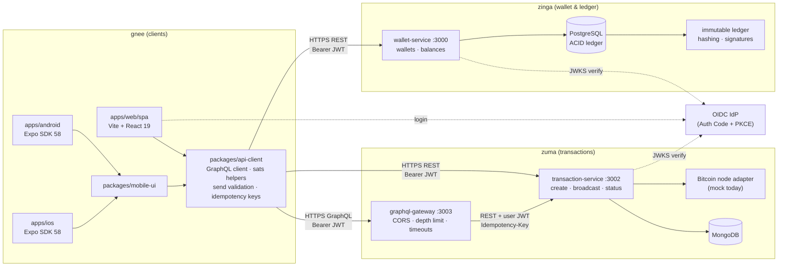

# Zhios Architecture

This document describes the system architecture for the Zhios Bitcoin wallet platform, including all microservices, clients, and supporting infrastructure.

## System Overview

Zhios is a multi-tier Bitcoin wallet platform with a clean architecture across four main sub-projects:

| Service | Purpose | Database | Stack |
|---------|---------|----------|-------|
| **zuma** | Transaction management backend | MongoDB | Fastify, Node.js, TypeScript |
| **zinga** | Wallet & ledger microservice with immutable PostgreSQL ledger | PostgreSQL | Fastify, Node.js, TypeScript |
| **gnee** | Mobile (iOS/Android) and web clients | N/A (backend clients) | React, Expo, TypeScript |
| **yone** | Reserved for future payment processing service | TBD | — |

## Data Flow Architecture

### Complete System Diagram



## Microservices Detail

### Zuma Services (Transaction Backend)

**Zuma** handles transaction management with MongoDB, including creation, signing, broadcasting, and lifecycle tracking.

#### Transaction Service (:3002)
- Create/sign transactions
- Broadcast to Bitcoin network (mock adapter today)
- Track transaction lifecycle: pending → broadcasting → confirmed | failed
- Failed sends trigger automatic refunds to zinga wallet-service
- REST API at `GET/POST /api/v1/transactions/...`
- Calls zinga wallet-service internally for balance checks and refunds

**Key invariants:**
- Sends are idempotent via `Idempotency-Key` (client-generated)
- Only `send` kind is implemented (receive via funding flow)
- Transaction status is single-source-of-truth
- Service-to-service calls use separate JWT secret (`INTERNAL_JWT_SECRET`)

#### GraphQL Gateway (:3003)
- Composes transaction REST service
- GraphQL schema over transaction operations
- Applies CORS, depth limits, timeouts
- No direct database access (all through REST services)
- GraphiQL explorer available in development

**Cross-service calls:**
```
transaction-service --[x-service-token]--> zinga wallet-service /internal (debits & refunds)
```

### Zinga Services (New Ledger Backend)

**Zinga** is the emerging ledger & wallet service using PostgreSQL with immutability guarantees via hashing and digital signatures.

#### Wallet Service (:3000)
- ACID-compliant wallet operations with PostgreSQL
- Real-time balance calculation from immutable ledger entries
- Address generation and management
- Wallet metadata (labels, multi-region support)
- REST API at `GET/POST /api/v1/wallets/...`
- Internal routes for service-to-service calls

**Architecture:**
- Clean Architecture layering:
  - `api/`: Fastify routes + JSON schema validation
  - `application/`: Use-cases, orchestrate domain + infrastructure
  - `domain/`: Wallet and ledger entities, value objects (database-agnostic)
  - `infrastructure/`: PostgreSQL adapters, HTTP clients, mock chain clients
- Each use-case is unit-testable with mocked repositories
- Service-to-service authentication via `x-service-token` (HS256)

#### PostgreSQL Ledger Schema

**Wallets table:**
```sql
CREATE TABLE wallets (
  id UUID PRIMARY KEY,
  label VARCHAR NOT NULL,
  address VARCHAR NOT NULL,
  network ENUM('mainnet', 'testnet'),
  type ENUM('hot', 'cold', 'multisig'),
  balance_sats BIGINT NOT NULL DEFAULT 0,
  status ENUM('active', 'suspended', 'closed') NOT NULL,
  metadata JSONB,
  owner_user_id VARCHAR,
  created_at TIMESTAMP DEFAULT NOW(),
  updated_at TIMESTAMP DEFAULT NOW()
);
```

**Ledger entries table (immutable):**
```sql
CREATE TABLE ledger_entries (
  id SERIAL PRIMARY KEY,
  wallet_id UUID NOT NULL REFERENCES wallets(id),
  transaction_id VARCHAR NOT NULL,
  kind ENUM('debit', 'credit') NOT NULL,
  reason VARCHAR NOT NULL,
  amount_sats BIGINT NOT NULL,
  balance_after_sats BIGINT NOT NULL,
  state VARCHAR,
  hash VARCHAR UNIQUE,
  previous_hash VARCHAR,
  digital_signature VARCHAR,
  verified_at TIMESTAMP,
  created_at TIMESTAMP DEFAULT NOW(),
  UNIQUE(transaction_id, kind, reason)
);
```

**Immutability enforcement:**
- All entries are INSERT-only (no UPDATE/DELETE)
- Hash chain: each entry includes hash of previous entry
- Digital signatures on critical entries
- PostgreSQL constraints and triggers prevent unauthorized changes
- Verification log tracks signature validation

#### Ledger Service
- Atomically applies balance movements (debits/credits)
- Prevents idempotent replay of same movement
- Calculates running balance after each entry
- Maintains hash chain for integrity verification
- Recovers wallet balance by replaying ledger entries

### Gnee Clients

**Gnee** provides a unified codebase for iOS, Android, and web clients, all sharing a TypeScript API client.

- **iOS/Android**: Expo SDK 58 with shared UI components (`packages/mobile-ui`)
- **Web SPA**: Vite + React 19, deployed as static HTML/CSS/JS
- **API Client**: GraphQL subscription client, amount formatting, send validation, idempotency key management

## Authentication

### User Authentication
- **Flow**: Authorization Code + PKCE
- **IdP**: External OIDC provider (mock IdP in local dev)
- **Tokens**: RS256 JWTs with claims: `sub` (user ID), `roles` (array), `aud` (service audience)
- **Verification**: Services fetch JWKS from IdP and validate signatures

**Token issuer varies by environment:**
- Local dev: `http://localhost:8090/zuma`
- Staging: `https://idp.staging.example.com`
- Production: Customer's OIDC provider

### Service-to-Service Authentication
- **Token type**: HS256 JWT (signed with `INTERNAL_JWT_SECRET`)
- **Claims**: `sub` (service name), `aud` (target service), `iss` (issuer, always `zuma-internal`)
- **Lifetime**: Short-lived (5 minutes typical)
- **Usage**: `x-service-token` header on internal API calls

## Money Invariants

All monetary values follow these rules throughout the system:

1. **Base unit is satoshis** (1 BTC = 100,000,000 sats)
2. **All amounts are integers** (no floating point)
3. **Strings on the wire** (JSON serialization)
4. **Validation pattern**: `^[0-9]+$` (SATS_AMOUNT_PATTERN)
5. **Type safety**: TypeScript `Cents` type in domain, validated at API boundary

**Zuma (Transaction) invariants:**
- Transaction status is single-source-of-truth
- Sends are idempotent via `Idempotency-Key` (client-generated)
- Failed transactions trigger automatic refunds to zinga wallet-service
- Service-to-service calls use separate JWT secret (`INTERNAL_JWT_SECRET`)

**Zinga invariants:**
- Ledger entries are immutable; balance computed from ledger
- Balance can be rebuilt from ledger entries (audit trail)
- Transactions include timestamp and signature
- Hashing prevents tampering with historical entries

## Deployment Architecture

### Local Development (medusa)
```
Mock OIDC :8090
MongoDB :27017 (internal)
zinga wallet-service :3000
zuma transaction-service :3002
zuma graphql-gateway :3003
PostgreSQL :5432 (internal)
gnee web-spa :8080
gnee mobile: Expo Dev Client
```

**Start:** `make deploy` (Terraform) or `make compose-up` (docker compose)

### Docker Swarm (scarlet/gru/cass)
```
Caddy TLS reverse proxy :80/:443
  -> gnee web-spa :8080
  -> zuma services :3002-3003
  -> zinga service :3000
MongoDB replica set
PostgreSQL primary + read replicas
```

**Deploy:** `docker stack deploy -c docker-stack.yml zhios`

### Kubernetes (EKS / any cluster)
```
Ingress + cert-manager
  -> gnee web-spa (nginx Deployment)
  -> zuma services (Deployment + Service)
  -> zinga service (Deployment + Service)
MongoDB StatefulSet (replica set)
PostgreSQL StatefulSet (primary + read replicas)
Observability: Prometheus, Grafana, Loki
```

**Deploy:** `kubectl apply -f zuma/infrastructure/kubernetes/`

### AWS (Lambda)
- zinga wallet-service (Lambda + RDS PostgreSQL)
- zuma transaction-service (Lambda + MongoDB Atlas or DocumentDB)
- Secrets from Secrets Manager and SSM Parameter Store
- API Gateway as HTTP entrypoint

## Cross-Service Communication

### REST API Calls
- All service-to-service calls use private service networks
- Public endpoints protected by API Gateway / Ingress / reverse proxy
- All calls include `Authorization: Bearer <token>` (user JWT or service token)

### Service-to-Service Endpoints

| Caller | Target | Path | Auth | Purpose |
|--------|--------|------|------|---------|
| zuma transaction-service | zinga wallet-service | `POST /internal/wallets/:id/debits` | x-service-token | Debit wallet for send |
| zuma transaction-service | zinga wallet-service | `POST /internal/wallets/:id/credits` | x-service-token | Refund failed transaction |
| zinga wallet-service | zuma transaction-service | (future) | x-service-token | Query external tx status |

## Clean Architecture Layers (per service)

All Fastify services follow Clean Architecture:

```
api/
  routes/              # HTTP routes, JSON schema validation, error mapping
  middleware/          # Auth, rate limiting, logging middleware
  dto/                 # Request/response DTOs

application/
  use-cases/           # One class per operation (e.g., CreateWallet, DebitWallet)
  ports/               # Abstract interfaces (WalletRepository, HttpClient, etc.)
  services/            # Domain-level services (e.g., LedgerMovement)

domain/
  entities/            # Wallet, Transaction, LedgerEntry (framework-free)
  value-objects/       # Network, Amount, Status (immutable, self-validating)
  ports/               # Port interfaces (same as application/ports conceptually)

infrastructure/
  persistence/         # Repository implementations (MongoDB, PostgreSQL)
  clients/             # HTTP, blockchain node clients
  config/              # Environment and config loaders
```

**Dependency rule:** Domain ← Application ← Infrastructure ← API

**Testability:** Swap infrastructure adapters with in-memory fakes; unit tests never touch the database.

## CI/CD Pipelines

### Zuma CI (`.github/workflows/zuma-ci.yml`)
- Lint, typecheck, unit tests
- Docker build + Trivy vulnerability scan
- Infrastructure linting (shellcheck, kubeconform)
- Terraform validation
- Security scanning (ggshield, Snyk)

### Zinga CI (`.github/workflows/zinga-ci.yml`)
- Lint, typecheck, unit tests
- Docker build + Trivy vulnerability scan
- Database schema validation

### Gnee CI
- Package linting/testing
- Web: full test suite, Playwright e2e, Docker build
- Mobile: Detox e2e on iOS/Android

## Known Limitations & Future Work

1. **Bitcoin adapter:** Transaction-service only has a mock adapter; RPC integration is a TODO
2. **Reconciliation:** No job yet for stuck transactions, failed refunds, or crashed ledger entries
3. **Image pinning:** Container images and GitHub Actions should be pinned by digest/SHA
4. **Zinga maturity:** PostgreSQL schema and ledger verification still in development; production readiness TBD
5. **Cross-service resilience:** Service-to-service calls (zuma → zinga) need retry/circuit-breaker patterns

## Related Documentation

- [`zuma/ARCHITECTURE.md`](zuma/README.md) — Zuma service architecture details
- [`zinga/ARCHITECTURE.md`](zinga/ARCHITECTURE.md) — Zinga service architecture details
- [`zuma/docs/domain-model.md`](zuma/docs/domain-model.md) — Entity design and value objects
- [`zuma/docs/security.md`](zuma/docs/security.md) — Authentication, authorization, and threat model
- [`gnee/README.md`](gnee/README.md) — Client architecture and deployment
