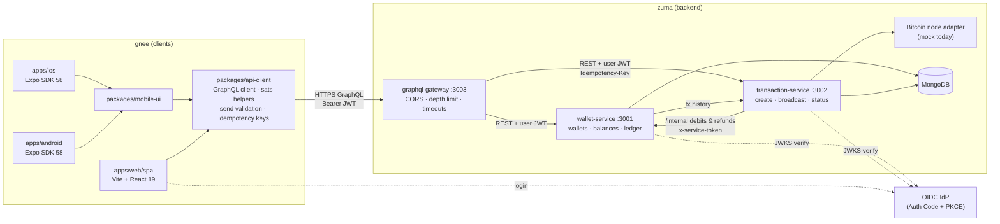
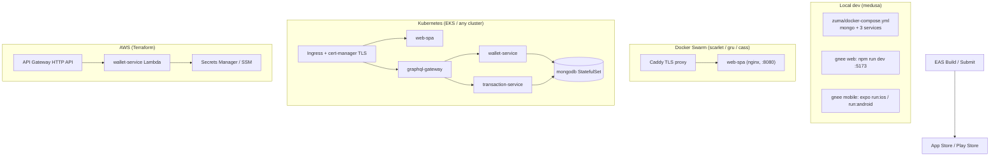
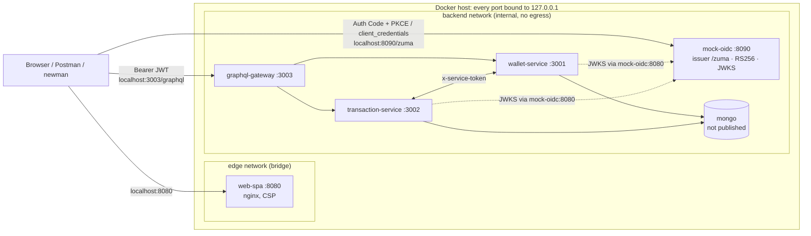

# Zhios

Monorepo for a Bitcoin wallet platform:

| Sub-project | What it is | Docs |
|---|---|---|
| [`zuma/`](zuma/README.md) | Backend: Fastify microservices (wallet, transaction) + GraphQL gateway, MongoDB, Clean Architecture | [zuma/README.md](zuma/README.md) |
| [`gnee/`](gnee/README.md) | Clients: Expo iOS/Android apps + Vite/React web SPA, sharing one TypeScript API client | [gnee/README.md](gnee/README.md) |
| [`yone/`](yone/README.md) | Reserved — not started yet | — |

## Architecture



Key invariants (details in [`zuma/docs/domain-model.md`](zuma/docs/domain-model.md) and [`zuma/docs/security.md`](zuma/docs/security.md)):

- Every amount and balance is an **integer number of satoshis** (a string on the wire), from the UI to the database.
- **`wallet-service` owns balances.** Every movement goes through an idempotent ledger, and debits use a guarded atomic update, so a wallet can't overspend and a retried request can't debit twice.
- **Sends are idempotent.** The client generates one `Idempotency-Key` per review session, the gateway forwards it, and `transaction-service` deduplicates on it.
- **Writes require ownership.** Every write checks that the caller owns the wallet. Admin and auditor roles can read but not write.
- **Services authenticate to each other with their own tokens.** Service-to-service calls carry a short-lived `x-service-token`, not the user's token.

## Deployment targets



## Lint, test, build

Each sub-project is its own npm-workspaces monorepo; run commands from inside it. Node 22 is required (`nvm use 22`).

| | `zuma/` | `gnee/` |
|---|---|---|
| Install | `npm ci` | `npm ci` |
| Lint (Biome) | `npm run lint` | `npm run lint` |
| Typecheck | `npm run typecheck` | `npm run typecheck` |
| Unit tests | `npm test --workspaces --if-present` | `npm test` |
| E2E | — (see `zuma/docs/testing-strategy.md`) | `npm run e2e -w @gnee/web-spa` (Playwright), Detox for mobile |
| Build | `npm run build` | `npm run build -w @gnee/web-spa` |

Before committing:

```zsh
ggshield secret scan path -r .
git commit -S -m "<type>: <message>"
```

## Deploy

### Local Docker stack

Both tools build the same stack from the repo root: zuma (mongo, wallet, transaction, gateway),
the gnee web SPA, and a **dev OIDC provider** ([`deploy/mock-oidc/server.mjs`](deploy/mock-oidc/server.mjs):
Node stdlib, Auth Code + PKCE, `client_credentials` personas, RS256/JWKS, a fixed issuer; tests in
`deploy/mock-oidc/server.test.mjs`), so the SPA login works without a real IdP. **Terraform is the default** (`infrastructure/terraform/docker`,
`kreuzwerker/docker`). **docker compose is the alternative/test path** (`docker-compose.yml`,
which includes `zuma/docker-compose.yml` and `gnee/infrastructure/docker/web-spa-compose.yml`).



The IdP and the zuma services also join `edge`, which is what publishes their ports. Mongo is
on `backend` only.

Quick start (Node 22 and Docker running; `make help` lists every target):

```zsh
# Terraform (default)
make secrets-local          # random local-only root .env (or: make secrets-op, from 1Password)
make deploy                 # terraform init + interactive apply: review the plan, type "yes"
bash scripts/compose-smoke-test.sh --no-up   # probe the Terraform stack
make destroy CONFIRM=yes    # Terraform asks again before deleting (includes the Mongo volume)

# docker compose (alternative / test)
make compose-up             # docker compose up -d --build --wait
make compose-test           # smoke test: PASS/FAIL table; leaves the stack up (ARGS=--down)
make compose-down
```

Run only one stack at a time, because both bind the same ports.

| URL | What |
|---|---|
| `http://localhost:8080` | gnee web SPA. Log in with any username; the optional claims box takes e.g. `{"roles":["admin"]}` |
| `http://localhost:3003/graphql` | GraphQL gateway (GraphiQL is on in development) |
| `http://localhost:3001/docs`, `:3002/docs` | wallet / transaction REST docs |
| `http://localhost:8090/zuma/.well-known/openid-configuration` | mock IdP discovery |

**Secrets.** They live only in the git-ignored root `.env` (mode 600), which you create in one
of two ways. `make secrets-local` runs `scripts/generate-local-secrets.sh` (openssl,
`umask 077`, refuses to overwrite). `make secrets-op` runs `op inject` of
`deploy/env/local.env.tpl`, which holds `op://zuma/local-stack/*` references only. Terraform
can skip the file entirely: `make deploy SECRETS_SOURCE=op` runs
`op run --env-file=deploy/env/terraform.env.tpl -- terraform apply`. The docker provider keeps
container env, and therefore secrets, in the local `terraform.tfstate` (git-ignored, mode 600),
so use local-only values.

**Tokens.** User tokens are RS256 JWTs from the mock IdP:

- `iss = http://localhost:8090/zuma`
- `aud` contains `zuma-api`
- `JWT_JWKS_URI = http://mock-oidc:8080/zuma/jwks`

zuma's auth plugin uses **either** JWKS **or** HS256, never both. This stack uses JWKS, so
HS256 tokens signed with `JWT_SECRET` are rejected. For scripted clients (Postman, newman,
curl), use `client_credentials` at `http://localhost:8090/zuma/token`. Any `client_id` /
`client_secret` is accepted. The `scope` selects the identity
(`deploy/mock-oidc/config.json`):

| `scope` | `sub` | `roles` |
|---|---|---|
| `zuma-admin` | `postman-admin` | `["admin"]` |
| `zuma-user` | `postman-user` | `["user"]` |
| `zuma-user-2` | `postman-user-2` | `["user"]` |
| `zuma-auditor` | `postman-auditor` | `["auditor"]` |

SPA logins (authorization_code) get `sub` = the username you typed, `roles: ["user"]` unless
the login form's claims JSON overrides them, and `aud: ["zuma-api","gnee-web-spa"]`.

**Troubleshooting**

| Symptom | Fix |
|---|---|
| Containers are healthy but every smoke check is `000`, Postman can't connect, or the browser gets nothing on `localhost:8080` | The Docker daemon is remote: your context is `ssh://…` (e.g. `scarlet-daemon`). Ports are published on **that host's** `127.0.0.1`. `make tunnel` forwards them to this machine's `localhost` over one SSH connection, so the `localhost` issuer and PKCE keep working; stop it with `make tunnel-stop`. `make compose-test` and `make postman` start it for you. To run on Docker Desktop instead: `docker context use desktop-linux`. |
| `bind source path does not exist` | Same cause: a remote daemon can't see your Mac's files. The stack has no host bind mounts (the mock-oidc config is baked into `zhios/mock-oidc:local`), so this only comes from local edits that add one. |
| `web-spa` unhealthy: `/etc/nginx/conf.d is not writable` | The tmpfs mounts need `mode=1777`, because nginx renders its templates as uid 101 (already set in compose and Terraform). Recreate the container: `docker compose up -d --force-recreate web-spa`. |
| Terraform: `Cannot connect to the Docker daemon` on macOS | Docker Desktop's socket is `unix://$HOME/.docker/run/docker.sock`. `scripts/terraform-run.sh` picks it up from `$DOCKER_HOST` or the docker context, or set `TF_VAR_docker_host` yourself. For the swarm manager use `ssh://_ai_daemon@scarlet`. |
| `port is already allocated` / `address already in use` | Another stack is running (compose vs Terraform, `zuma/` compose, `npm run dev`, Vite on 5173 is fine). Find it with `lsof -nP -iTCP:<port> -sTCP:LISTEN`, or override `WEB_PORT`/`IDP_PORT`/... (compose) or `TF_VAR_web_port`/... (Terraform). Changing the IdP port changes the issuer. |
| API returns 401 after a successful SPA login | Issuer mismatch: the token's `iss` comes from the Host you used. Always use `localhost:8090`, never `127.0.0.1:8090`. `JWT_ISSUER` must be the browser URL, and only `JWT_JWKS_URI` uses `mock-oidc`. After an IdP restart, log in again, because its signing keys are regenerated. |
| `graphql-gateway` exits at startup (Fastify version error) | mercurius@14 refuses Fastify 5. Run `cd zuma && npm install mercurius@^16 -w @zuma/graphql-gateway`, then rebuild (the Dockerfiles `npm ci` from the lockfile). |
| `transaction-service` config error | Local runs need `NODE_ENV=development` + `BITCOIN_ADAPTER=mock` (already set by both paths). |
| Mongo auth failed after regenerating `.env` | The volume keeps the old root password. Wipe it with `docker compose down -v` or `make destroy CONFIRM=yes` (this deletes local data). |
| Terraform image build fails on `RUN --mount` | Run `make build-images`, then `TF_VAR_build_images=false make deploy`. |

### Other targets

| What | How | Docs |
|---|---|---|
| zuma only, local (HS256) | `cd zuma && ./scripts/dev-up.sh --full` | [zuma/README.md](zuma/README.md#deploy) |
| zuma, Kubernetes | `kubectl apply` of `zuma/infrastructure/kubernetes/` (secrets via External Secrets / Sealed Secrets) | [zuma/infrastructure/README.md](zuma/infrastructure/README.md) |
| zuma, AWS Lambda | `zuma/scripts/package-lambda.sh` then `terraform plan` / `apply` in `zuma/infrastructure/aws/terraform` | [zuma/infrastructure/README.md](zuma/infrastructure/README.md#aws-terraform) |
| gnee web | `gnee/scripts/deploy-{docker,swarm,k8s}.sh` | [gnee/infrastructure/README.md](gnee/infrastructure/README.md) |
| gnee mobile | `gnee/scripts/deploy-mobile.sh {ios,android} production` | [gnee/infrastructure/README.md](gnee/infrastructure/README.md) |

All deploy-time secrets come from 1Password (`op read` / `op plugin run`) or the cloud secret manager. Nothing secret is committed; the `secret.yaml` files only hold `CHANGE_ME` templates.

## CI (`.github/workflows/`)

| Workflow | Jobs |
|---|---|
| `zuma-ci.yml` | lint, build, test, secret-scan, infra-lint (shellcheck, hadolint, kubeconform, compose), terraform fmt/validate, docker-build + Trivy, security |
| `gnee-packages-ci.yml` | lint, typecheck, test, security |
| `gnee-web-ci.yml` | lint, typecheck, test, build, Playwright e2e, secret-scan, infra-lint, terraform, docker-build + Trivy, security |
| `gnee-ios-ci.yml` / `gnee-android-ci.yml` | lint, typecheck, test, Detox e2e, security |

Each workflow runs only when files under its path filters change, and has `permissions: contents: read`. Third-party actions are still pinned by tag, not commit SHA; each workflow carries a TODO header to fix that.

## Known gaps

- `transaction-service` only has a **mock** Bitcoin node adapter. Production config requires `BITCOIN_ADAPTER=rpc`, which isn't implemented yet.
- There's no reconciliation job yet for sends stuck in `broadcasting`, debits that never completed, or failed sends that were never refunded.
- Container images and GitHub Actions still need to be pinned by digest/SHA, and the TLS issuers need configuring.
- The Mongo repository integration tests use `mongodb-memory-server`, so they need a machine that can bind local ports.
