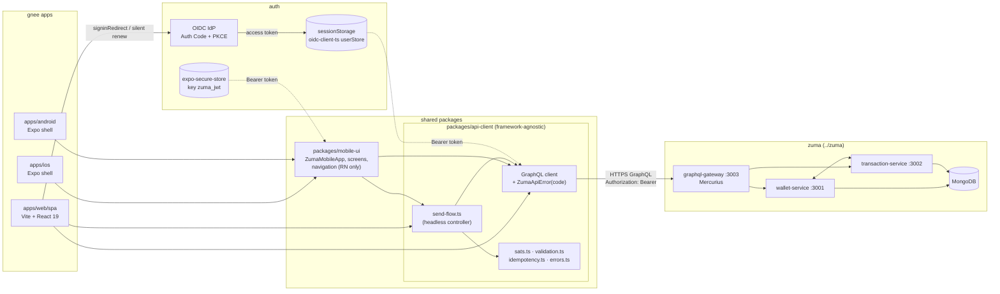
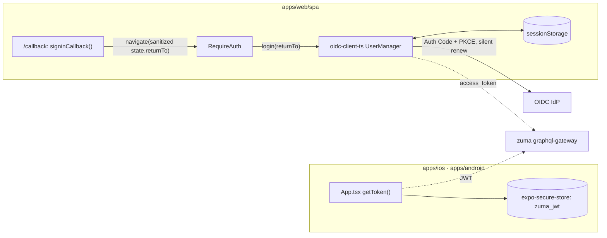

# gnee

Client apps for the `zuma` Bitcoin wallet & transaction platform: iOS,
Android and a web SPA.

## Decision

**Strategy:** React Native (Expo SDK 58, React Native 0.88, React 19.3,
react-navigation 7) for mobile, React 19.3 + Vite for web. Everything is
TypeScript, matching zuma's own stack (Fastify/TS services + a GraphQL
gateway). Native Swift/Kotlin, Kotlin Multiplatform and Flutter were also
considered. This option was chosen because it gives the most reuse and the
least duplicated effort:

- One language (TypeScript) across every app and shared package. Types for
  zuma's GraphQL schema are written once and imported everywhere.
- `apps/ios` and `apps/android` are thin Expo shells: a ~15-line `App.tsx`
  plus bundle id / package name and secure token storage. All screens,
  navigation and data fetching live once in `packages/mobile-ui`
  (`<ZumaMobileApp>`).
- `apps/web/spa` reuses the same `packages/api-client` as the mobile apps
  (GraphQL client, types, sats/validation/idempotency helpers and the headless
  send-flow controller). A schema change in `zuma/graphql` is therefore a
  one-package update.

## Architecture



## Layout

```
gnee/
  packages/
    api-client/   # Framework-agnostic TS: GraphQL client + types mirroring zuma's SDL, sats/BTC helpers,
                  # send-form validation, idempotency keys, error-code mapping, headless send-flow controller.
    mobile-ui/    # Shared React Native app (<ZumaMobileApp>, screens, navigation). Used by apps/ios and apps/android only.
  apps/
    ios/          # Expo app shell: App.tsx + app.json/app.config.ts + eas.json
    android/      # Expo app shell: same, Android flavour
    web/
      spa/        # Vite + React SPA with its own DOM pages and OIDC auth, using the same @gnee/api-client
  infrastructure/ # Docker / Swarm / Kubernetes for web/spa. See infrastructure/README.md
  scripts/        # deploy-docker.sh, deploy-swarm.sh, deploy-k8s.sh, deploy-mobile.sh
```

## Prerequisites

Start zuma first (from the repo root):

```bash
cd ../zuma
chmod +x scripts/*.sh   # once, after cloning
./scripts/dev-up.sh --full
```

This starts `wallet-service` (3001), `transaction-service` (3002) and
`graphql-gateway` (3003). The GraphQL gateway is the only endpoint the gnee
apps talk to.

## Running an app

Each app has its own `README.md` and `env.example`. The general pattern, run
from `gnee/`:

```bash
npm install                       # installs all workspaces (packages + apps)
npm run dev -w @gnee/web-spa      # web SPA, http://localhost:5173
npm run ios -w @gnee/ios          # iOS simulator (macOS + Xcode required)
npm run android -w @gnee/android  # Android emulator (Android Studio required)
```

## Money, validation and the send flow

- **Amounts are integer satoshis as strings** (`"150000"`), end to end. They
  never pass through a JS `number`. `packages/api-client/src/sats.ts` does
  parsing (`parseBtcInputToSats`, `parseSatsInput`) and formatting
  (`formatBtc` → `0.00150000 BTC`, `formatSats` → `150,000 sats`) with
  `bigint` only.
- **Send form**: the user picks the unit explicitly (**BTC** or **sats**
  toggle; labels read "Amount (BTC)" / "Amount (sats)"). Errors appear per
  field while typing. `validateSendForm` checks:
  - the address shape plus the network prefix (bech32 `bc`/`tb`/`bcrt`; base58 `1`/`3` vs `m`/`n`/`2`)
  - that the amount is greater than 0 and no more than the balance
  - that the fee rate is a whole number from 1 to 10000 sat/vB

  The server still re-validates everything, including the full bech32
  checksum.
- **Review → confirm**: a review step shows destination, amount (BTC + sats),
  fee rate and network. Entering review generates **one** idempotency key
  (`crypto.randomUUID`, falling back to `crypto.getRandomValues`, never
  `Math.random`). Every confirm or retry in that review session reuses the
  same key, so a double click, a lost response or a retry can't send twice.
  Going back to edit ends the session; the next review gets a fresh key.
- **Errors**: `ZumaApiError` exposes the gateway's `extensions.code` and its
  client-safe message. `describeZumaError` maps codes such as
  `INSUFFICIENT_FUNDS`, `WALLET_NOT_ACTIVE`, `IDEMPOTENCY_CONFLICT` and
  `FORBIDDEN` to friendly text. For `VALIDATION_ERROR`/`BAD_USER_INPUT` it
  shows the server's message as-is.
- The logic lives in `createSendFlow` (api-client, no React import). Web and
  mobile bind it with a ~25-line `useSendFlow` hook built on
  `useSyncExternalStore` (`apps/web/spa/src/hooks/`,
  `packages/mobile-ui/src/hooks/`). Each app uses its own copy of React, so
  there's no risk of loading two React instances.

```mermaid
sequenceDiagram
  actor U as User
  participant F as Send form (web / mobile)
  participant C as createSendFlow (api-client)
  participant G as graphql-gateway
  participant T as transaction-service

  U->>F: destination, amount (BTC or sats), fee rate
  F->>C: setField / setUnit
  C->>C: parseAmountInput → sats string, validateSendForm(network, balance)
  C-->>F: visibleErrors (live)
  U->>F: Review send
  F->>C: review()
  C->>C: idempotencyKey = createIdempotencyKey() (once per review session)
  C-->>F: step=review, draft (destination, amount, fee rate, network)
  U->>F: Confirm and send
  F->>C: confirm() (no-op while in flight)
  C->>G: mutation createTransaction(input: {walletId, amount, feeRate, destinationAddress, idempotencyKey})
  G->>G: check idempotencyKey + sats patterns
  G->>T: POST /api/v1/transactions (Idempotency-Key header, type=send)
  T->>T: validate address for wallet network, balance, wallet status
  alt success
    T-->>G: transaction
    G-->>C: Transaction
    C-->>F: step=success → navigate to wallet detail (refetch)
  else error (e.g. INSUFFICIENT_FUNDS, network failure)
    T-->>G: {code, message}
    G-->>C: errors[].extensions.code
    C-->>F: step=review, friendly submitError; retry reuses the SAME key
  end
```

## Auth



- **`apps/web/spa`**: OpenID Connect, Authorization Code + PKCE, via
  `oidc-client-ts`, against a configurable external IdP.
  - The user store is **`sessionStorage`**, not `localStorage`. Sessions are
    per tab and end when the tab closes, which shrinks the exposure window
    for XSS or a shared machine.
  - `automaticSilentRenew` is on. `getAccessToken()` renews an expired token
    silently. If renewal fails it returns `undefined`, never a stale token.
  - The return path survives the IdP round-trip via `state` and is checked
    on the way back: only same-origin paths are accepted (no open redirect).
  - Audience and scope come from `VITE_OIDC_AUDIENCE` / `VITE_OIDC_SCOPE`.
  - See `apps/web/spa/README.md`.
- **`apps/ios` / `apps/android`**: no login screen yet. Each app reads a JWT
  from `expo-secure-store` under the key `zuma_jwt` and sends it as
  `Authorization: Bearer <token>`. Seed it manually for local testing; see
  each app's `README.md`.

In both cases zuma's `requireAuth` verifies the token. See
`zuma/docs/security.md` ("OIDC / JWKS path"). Wallet ownership is always
taken from the token, so clients can't set `ownerUserId`.

## Lint

```bash
npm run lint           # = biome lint . (Biome 2, config in biome.json; replaces ESLint)
npm run format:check   # biome format . (formatter currently disabled in biome.json)
```

## Typecheck

```bash
npm run typecheck      # tsc --noEmit in every workspace
```

## Test

| Layer | Command | Notes |
|---|---|---|
| Unit, all workspaces | `npm test` | runs each workspace's `test` script |
| api-client | `npm test -w @gnee/api-client` | jest + ts-jest: sats, validation, idempotency, error mapping, send-flow, queries |
| mobile-ui | `npm test -w @gnee/mobile-ui` | jest-expo + RNTL 13 (screens, review step) |
| ios / android shells | `npm test -w @gnee/ios`, `npm test -w @gnee/android` | App renders `<ZumaMobileApp>` |
| web unit | `npm test -w @gnee/web-spa` | vitest + jsdom + RTL (send review/confirm, error mapping, no double submit) |
| web e2e | `npm run e2e -w @gnee/web-spa` | Playwright, gateway stubbed by operation name, fake OIDC session seeded in `sessionStorage` |
| mobile e2e | `npm run e2e:build` / `e2e:test` in `apps/ios` or `apps/android` | Detox. Needs a simulator/emulator and the `@config-plugins/detox` config plugin (not installed yet). See the app READMEs |

## Deploy

See [`infrastructure/README.md`](infrastructure/README.md) for details. Every
script resolves config from environment variables first, then 1Password
`op read`. A failed or empty read aborts the script, and nothing secret is
checked in or baked into images.

For the web SPA running locally against the real zuma backend and a mock OIDC provider (login
works with no real IdP), deploy the whole stack from the repo root: `make secrets-local && make deploy`
(Terraform, the default) or `make compose-up && make compose-test` (docker compose). See
[../README.md#deploy](../README.md#deploy). The compose definition for the SPA is
[`infrastructure/docker/web-spa-compose.yml`](infrastructure/docker/web-spa-compose.yml): read-only
rootfs, `cap_drop: ALL`, uid 101, `127.0.0.1:8080`.

| Target | Command | What it does |
|---|---|---|
| Full local stack | repo root: `make deploy` / `make compose-up` | web-spa + zuma + mock OIDC on `127.0.0.1` |
| Local container (SPA only) | [`scripts/deploy-docker.sh`](scripts/deploy-docker.sh) | builds `web-spa` (Vite → nginx-unprivileged) and runs it on `http://localhost:8080` (localhost is a secure context, so no TLS) |
| Docker Swarm | `REGISTRY=… SITE_ADDRESS=… ./scripts/deploy-swarm.sh` ([script](scripts/deploy-swarm.sh)) | build + push, then `docker stack deploy` of `web-spa` behind a **Caddy TLS proxy** (`infrastructure/docker/web-spa-stack.yml`, `Caddyfile`). Use `docker context use scarlet-daemon` first |
| Kubernetes | `REGISTRY=… WEB_SPA_HOST=… CERT_MANAGER_CLUSTER_ISSUER=… ./scripts/deploy-k8s.sh` ([script](scripts/deploy-k8s.sh)) | build + push, then `terraform apply` (prompts) of `infrastructure/terraform/kubernetes`. Covers the TLS **Ingress** via cert-manager, NetworkPolicy, HPA and PDB |
| iOS / Android | `./scripts/deploy-mobile.sh <ios\|android> <profile>` ([script](scripts/deploy-mobile.sh)) | **EAS Build/Submit**. App Store Connect / Play credentials go to 0600 temp files and are deleted on exit |

Remote web deploys refuse non-`https` or loopback gateway, authority and
redirect URLs.

## Devcontainers

Each workspace has its own `.devcontainer/devcontainer.json` (VS Code /
`devcontainer` CLI). Each one opens the whole `gnee/` tree, because the npm
workspace symlinks need it, in a Node 22 container with the Biome extension.
Each also pre-installs what that workspace needs: the Android SDK + JDK for
`apps/android`, and Playwright's browsers for `apps/web/spa`. `apps/ios`'s
container is JS/TS-only, since iOS builds still need macOS + Xcode on the
host.
