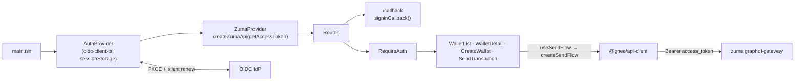

# @gnee/web-spa

Web SPA for the Zuma wallet app (React 19 + Vite, TypeScript strict). It uses
the same [`@gnee/api-client`](../../../packages/api-client) as
[`@gnee/ios`](../../ios) and [`@gnee/android`](../../android). That covers
the GraphQL client, types, sats formatting, send validation and the headless
send-flow controller. Only the UI layer (DOM here, React Native there) is
different.



## Run

```bash
cd gnee/apps/web/spa
npm install                                    # from gnee/ (workspaces)
op run --env-file=env.example -- npm run dev   # resolves op:// refs from 1Password, writes nothing to disk
```

Requires the zuma `graphql-gateway` (and the two REST services behind it).
Start them with `../zuma/scripts/dev-up.sh --full`.

## Auth

OpenID Connect, Authorization Code + PKCE, via `oidc-client-ts` (`src/auth/`).

- **Token storage:** `WebStorageStateStore({ store: window.sessionStorage })`.
  Sessions are per tab and are gone when the tab closes.
- **Renewal:** `automaticSilentRenew: true`. `getAccessToken()` is
  referentially stable. It returns the token while valid, tries a silent
  renew once expired, and returns `undefined` if renewal fails, never an
  expired token. If renewal fails after expiry, the session is removed and
  `<RequireAuth>` starts a fresh login.
- **Return path:** `<RequireAuth>` passes the current URL as
  `signinRedirect({ state: { returnTo } })`. `/callback`
  (`signinCallback()`, which also handles the silent-renew iframe) navigates
  there only if it's a same-origin path (`src/auth/returnTo.ts`), so it can't
  be used as an open redirect.
- **Config:** set `VITE_OIDC_AUTHORITY`, `VITE_OIDC_CLIENT_ID`,
  `VITE_OIDC_SCOPE` (default `openid profile email`) and
  `VITE_OIDC_AUDIENCE` (sent as `audience`; must equal zuma's
  `JWT_AUDIENCE`). See `env.example`.

Register a **public SPA client** with your IdP: no client secret, and add
`http://localhost:5173/callback` as a redirect URI. zuma's services must
trust the same IdP's JWKS (`JWT_JWKS_URI`); see `zuma/docs/security.md`.

## Send flow

`/wallets/:id/send` works in three steps:

1. **Form.** Pick the unit with the BTC / sats toggle (labels
   "Amount (BTC)" / "Amount (sats)"). Field errors show while you type: the
   address must match the wallet's network, the amount must be > 0 and no
   more than the balance, and the fee rate must be 1–10000 sat/vB.
2. **Review and confirm.** Shows destination, amount, fee rate and network.
   One idempotency key is created per review session and reused on every
   retry.
3. **Success.** Navigates back to the wallet detail page, which refetches.

Confirm is disabled while a request is in flight. Error codes are mapped to
friendly messages by `describeZumaError`.

## Lint / Typecheck / Test

```bash
npm run lint        # biome lint .
npm run typecheck   # tsc --noEmit
npm test            # vitest unit tests (src/**/*.test.tsx), jsdom + RTL
npx playwright install --with-deps chromium   # once
npm run e2e         # playwright (e2e/**/*.spec.ts); CI reporters: github + html (open: never)
```

E2E specs stub the gateway at the network level by GraphQL operation name
(`e2e/helpers.ts`). They also seed a fake OIDC session into
**sessionStorage** (`mockOidcSession`) against the fixed test
authority/client id set in `playwright.config.ts`. No backend or real IdP is
needed.

## Deploy

```bash
../../../scripts/deploy-docker.sh                       # local container, http://localhost:8080
REGISTRY=… SITE_ADDRESS=… ../../../scripts/deploy-swarm.sh   # swarm + Caddy TLS
REGISTRY=… WEB_SPA_HOST=… CERT_MANAGER_CLUSTER_ISSUER=… ../../../scripts/deploy-k8s.sh   # k8s + TLS ingress
```

Config comes from env vars or 1Password `op read`. See
[`infrastructure/README.md`](../../../infrastructure/README.md).
