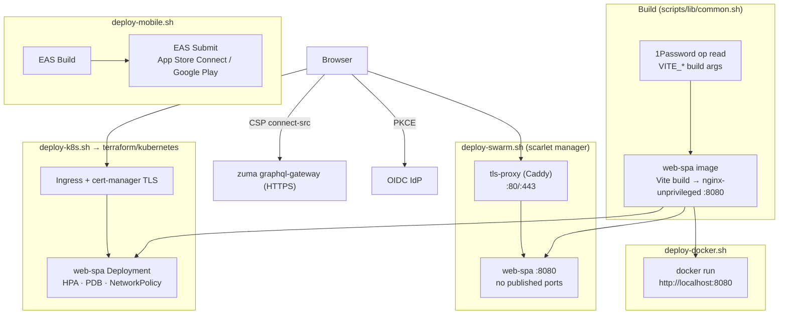

# gnee infrastructure

Deploy paths for `apps/web/spa` — the only `gnee` app that runs in a
container. `apps/ios`/`apps/android` ship as signed binaries via EAS
Build/Submit instead; see `scripts/deploy-mobile.sh` and each app's README.

## Topology



The nginx response headers are CSP (`default-src 'self'`; `connect-src` limited to the gateway and IdP origins; `frame-ancestors 'none'`), HSTS, `X-Content-Type-Options: nosniff`, `Referrer-Policy: strict-origin-when-cross-origin`, and `Permissions-Policy`.

## Layout

```
infrastructure/
  docker/
    web-spa.Dockerfile             # multi-stage build (Vite build -> nginx-unprivileged, uid 101, :8080)
    web-spa.nginx.conf             # envsubst template: SPA fallback, /healthz, cache headers
    web-spa.security-headers.inc   # envsubst template: CSP, HSTS, nosniff, Referrer/Permissions-Policy
    web-spa-stack.yml              # swarm stack: web-spa + Caddy TLS proxy
    Caddyfile                      # TLS termination for the swarm stack (swarm `configs:`)
  kubernetes/
    namespace.yaml                 # "gnee" namespace, Pod Security "restricted"
    web-spa/
      deployment.yaml              # non-root, read-only rootfs, probes on /healthz, no replicas (HPA owns them)
      configmap.yaml               # CSP connect-src origins (non-secret)
      service.yaml
      hpa.yaml
      pdb.yaml
      networkpolicy.yaml           # default-deny; only the ingress controller may reach :8080
      ingress.yaml                 # HTTPS via cert-manager
  terraform/
    kubernetes/                    # applies the YAML above via the `kubernetes` provider
scripts/
  lib/common.sh                    # op_read_required, URL/origin checks, shared image build
  deploy-docker.sh                 # local: docker build + docker run (http://localhost:8080)
  deploy-swarm.sh                  # docker build + push + `docker stack deploy`
  deploy-k8s.sh                    # docker build + push + `terraform apply` (infrastructure/terraform/kubernetes)
  deploy-mobile.sh                 # EAS Build/Submit for apps/ios or apps/android
```

## Config model

`apps/web/spa` is a public OIDC SPA client (Authorization Code + PKCE — no
client secret by design) talking to a public GraphQL gateway URL. Its
`VITE_*` config is baked into the static bundle at `vite build` time, so
nothing secret is injected into the container. Roll out a new image
(`--build-arg ...`) per environment.

The only runtime config is the Content-Security-Policy's allowed origins,
rendered into the nginx config at container start by the image's envsubst
entrypoint (non-secret, `configmap.yaml` / stack `environment:`):

| Variable | Example | Must match |
|---|---|---|
| `ZUMA_GATEWAY_ORIGIN` | `https://api.wallet.example.com` | origin of `VITE_ZUMA_GATEWAY_URL` |
| `OIDC_AUTHORITY_ORIGIN` | `https://idp.example.com` | origin of `VITE_OIDC_AUTHORITY` |

The deploy scripts derive both from the build args automatically. If your
IdP serves its token/JWKS endpoints from a different origin than the
authority, extend `connect-src` in `web-spa.security-headers.inc`.

## TLS (required)

OIDC PKCE needs a secure context (`crypto.subtle`), and an `https` page
cannot call an `http` API, so every non-local deploy serves HTTPS — and the
zuma gateway must be HTTPS too. `localhost` counts as a secure context, which
is why `deploy-docker.sh` can stay on plain HTTP.

- **Kubernetes:** `web-spa/ingress.yaml` (and zuma's
  `graphql-gateway/ingress.yaml`) terminate TLS at the ingress controller with
  a cert-manager certificate. Install cert-manager, create a `ClusterIssuer`,
  and pass its name as `CERT_MANAGER_CLUSTER_ISSUER`.
- **Swarm:** the `tls-proxy` (Caddy) service publishes 80/443 and proxies to
  `web-spa:8080`; `web-spa` publishes no ports. The `Caddyfile` defaults to
  `tls internal` (Caddy's local CA — trust its root on LAN clients). For a
  public hostname drop the `tls` line (automatic ACME), or mount your own
  cert/key as Docker secrets — options are documented in the `Caddyfile`.
  Caddy runs from a static config, so no Docker socket is mounted.

`Strict-Transport-Security` is always sent but browsers only honour it over
HTTPS, i.e. once one of the TLS front ends above is in place.

## 1Password layout

Deploy scripts resolve config from environment variables first, then
`op read`. A failed or empty `op read` aborts the script — there are no
silent fallbacks. Remote deploys (`deploy-swarm.sh`, `deploy-k8s.sh`) refuse
non-`https` or loopback gateway/authority/redirect URLs.

| Reference | Used by | Contains |
|---|---|---|
| `op://zuma/web-spa-oidc/gateway_url` | `deploy-swarm.sh`, `deploy-k8s.sh` (local uses `http://localhost:3003/graphql`) | `VITE_ZUMA_GATEWAY_URL` |
| `op://zuma/web-spa-oidc/authority` | all web deploy scripts | `VITE_OIDC_AUTHORITY` |
| `op://zuma/web-spa-oidc/client_id` | all web deploy scripts | `VITE_OIDC_CLIENT_ID` |
| `op://zuma/web-spa-oidc/audience` | all web deploy scripts (set `VITE_OIDC_AUDIENCE=""` to skip) | `VITE_OIDC_AUDIENCE` — zuma's `JWT_AUDIENCE` |
| `op://zuma/eas/expo_token` | `deploy-mobile.sh` | EAS CI auth token (`EXPO_TOKEN`) |
| `op://zuma/eas-ios/asc_api_key_p8`, `asc_api_key_id`, `asc_api_key_issuer_id` | `deploy-mobile.sh` (ios) | App Store Connect API key, for non-interactive `eas submit` |
| `op://zuma/eas-android/service_account_json` | `deploy-mobile.sh` (android) | Google Play service account key |

`VITE_OIDC_SCOPE` defaults to `openid profile email`. `deploy-mobile.sh`
writes key material only to `mktemp` files under `umask 077`, after
`eas build` (so it can never be part of the uploaded project archive); the
Play key is exposed at `apps/android/google-service-account.json` (the path
`eas.json` expects) as a symlink for the duration of `eas submit`, and both
are deleted on exit. Set `EAS_CLI_VERSION` to pin eas-cli.

zuma's own `JWT_JWKS_URI`/`JWT_AUDIENCE` (so the services accept the
OIDC-issued tokens this SPA sends) follow the same convention — see
`zuma/docs/security.md`'s "OIDC / JWKS path".

## Running a deploy

```bash
chmod +x scripts/*.sh   # once, after cloning

./scripts/deploy-docker.sh                                   # local container, http://localhost:8080
REGISTRY=scarlet:5000 SITE_ADDRESS=wallet.example.com \
  ./scripts/deploy-swarm.sh                                  # docker context use scarlet-daemon first
REGISTRY=your-registry.example.com WEB_SPA_HOST=wallet.example.com \
  CERT_MANAGER_CLUSTER_ISSUER=letsencrypt-prod \
  ./scripts/deploy-k8s.sh                                    # terraform apply prompts for confirmation
./scripts/deploy-mobile.sh ios production
./scripts/deploy-mobile.sh android production
```

`IMAGE_TAG` defaults to the short git SHA; images are never deployed as
`:latest` (the Terraform module rejects it). Base images are pinned to exact
tags with `TODO: pin by digest` markers — resolve with
`docker buildx imagetools inspect <image>` and append `@sha256:...`.

Per CLAUDE.md's guardrails: none of these scripts auto-approve `terraform
apply` or skip confirmation — `deploy-k8s.sh` will prompt in your terminal.
`docker stack deploy`/`terraform apply` against a shared/production system
should still be a deliberate, reviewed action.

## Lint and validate

Run from `gnee/`. CI runs the same checks in `gnee-web-ci.yml`.

```zsh
shellcheck scripts/*.sh scripts/lib/*.sh
docker run --rm -i hadolint/hadolint:v2.12.0 hadolint - < infrastructure/docker/web-spa.Dockerfile
docker run --rm -v "$PWD/infrastructure/kubernetes:/k:ro" ghcr.io/yannh/kubeconform:v0.6.7 -strict -summary -ignore-missing-schemas /k
docker compose -f infrastructure/docker/web-spa-stack.yml config -q
terraform -chdir=infrastructure/terraform/kubernetes fmt -check
terraform -chdir=infrastructure/terraform/kubernetes init -backend=false -input=false && terraform -chdir=infrastructure/terraform/kubernetes validate
```
