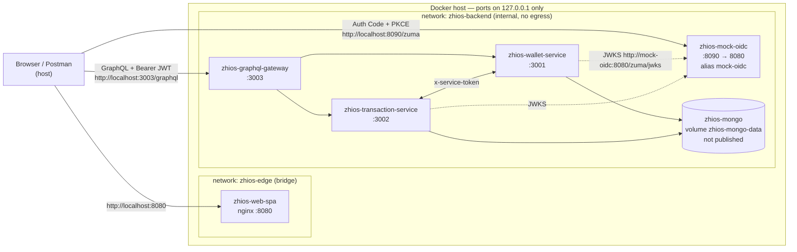

# Terraform: local Docker deploy (default path)

Deploys the full local zhios stack to one Docker engine with the
[`kreuzwerker/docker`](https://registry.terraform.io/providers/kreuzwerker/docker/latest/docs)
provider (`~> 3.6`). It builds the same topology as the root `docker-compose.yml`, which is
the alternative/test path.



The IdP and the zuma services sit on both networks. `zhios-backend` is internal, and
`zhios-edge` carries the published ports. Only `web-spa` is edge-only, and only `mongo` is
backend-only.

## Usage

From the repo root:

```zsh
make secrets-local      # or: make secrets-op (1Password), or neither and use op run directly
make deploy             # terraform init + interactive apply (type "yes")
make tf-output          # URLs + OIDC endpoints
bash scripts/compose-smoke-test.sh --no-up   # same smoke test, against the Terraform stack
make destroy CONFIRM=yes
```

To use 1Password without writing a `.env`:

```zsh
op run --env-file=deploy/env/terraform.env.tpl -- terraform -chdir=infrastructure/terraform/docker apply
```

`make deploy SECRETS_SOURCE=op` does the same thing. See `scripts/terraform-run.sh` for how
`auto` / `op` / `dotenv` are chosen.

## Docker endpoint (`docker_host`)

| Engine | Value |
|---|---|
| Linux | `unix:///var/run/docker.sock` (default) |
| Docker Desktop, macOS | `unix:///Users/<you>/.docker/run/docker.sock`. `scripts/terraform-run.sh` detects this from `$DOCKER_HOST` or the current docker context, or set `TF_VAR_docker_host="unix://$HOME/.docker/run/docker.sock"` |
| Swarm manager | `ssh://_ai_daemon@scarlet`. This creates plain containers (not swarm services) on scarlet, with ports on scarlet's loopback, and the build context is uploaded over SSH. The SPA's baked-in `localhost` URLs only work from a browser on that host or through an SSH tunnel. |

## Images

`build_images = true` (the default) builds `zhios/{wallet-service,transaction-service,graphql-gateway,web-spa}:local`
with `docker_image` build blocks. The builds go through buildx (`buildx_builder = "default"`)
because the Dockerfiles use `RUN --mount=type=cache`, which the 3.x provider's legacy builder
rejects. A hash of each image's source files triggers a rebuild when they change.

If the provider's build path gives you trouble on your engine, run `make build-images`
(`docker compose build`, which produces the same tags) and apply with
`TF_VAR_build_images=false`.

## Auth wiring (mock OIDC)

| | Value |
|---|---|
| Issuer (`JWT_ISSUER`, token `iss`) | `http://localhost:8090/zuma`, the URL the browser sees |
| JWKS (`JWT_JWKS_URI`) | `http://mock-oidc:8080/zuma/jwks`, reached over the internal network |
| Audience (`JWT_AUDIENCE`) | `zuma-api` |
| SPA client | `gnee-web-spa`, public, Auth Code + PKCE, redirect `http://localhost:8080/callback` |

The IdP is `deploy/mock-oidc/server.mjs`, built into `zhios/mock-oidc:<tag>` with
`deploy/mock-oidc/config.json` (personas) baked in. It's the same image compose builds, so it also
works with a remote `docker_host`, since nothing is bind-mounted. The issuer is fixed through `ISSUER`.

## Secrets and state

- Secrets are `sensitive = true` variables: `mongo_root_password`, `jwt_secret`,
  `internal_jwt_secret`, `metrics_token`. Supply them only as `TF_VAR_*` (`op run` or
  `scripts/terraform-run.sh`). Never put them in `terraform.tfvars`.
- The docker provider stores each container's `env` in state, and that includes the secrets.
  State uses the **local backend** (`terraform.tfstate`), which is git-ignored and kept at mode
  600. No saved plan files are written, because a plan file would hold the secrets in
  plaintext. Use local-only values here, never production secrets.
- `NODE_ENV=development` and `BITCOIN_ADAPTER=mock` are deliberate. This stack has no Bitcoin
  node, and production config rejects the mock adapter.

## Files

| File | Purpose |
|---|---|
| `versions.tf` | Terraform/provider constraints, local backend, provider config |
| `variables.tf` | Endpoint, images, ports, sensitive secrets |
| `main.tf` | Networks, volume, images, six containers (healthchecks, read-only rootfs, `cap_drop ALL`, non-root users, `no-new-privileges`, labels `com.zhios.*`) |
| `outputs.tf` | URLs, OIDC endpoints, container names |
| `terraform.tfvars.example` | Non-secret overrides only |
