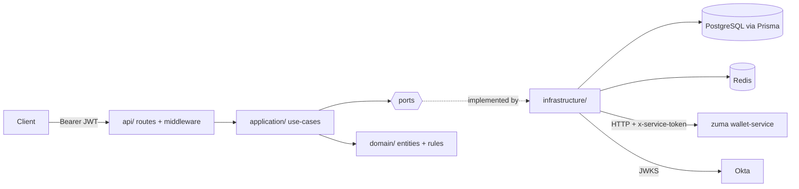

# Architecture

ozzo is an independent service (no code shared with `zuma/`) following the same Clean Architecture layering.

| Layer | Depends on | Contents |
|---|---|---|
| `domain/` | nothing (no Fastify, Prisma, Redis) | `User`, `BankAccount`, value-object validation, `DomainError` hierarchy |
| `application/` | domain | use-cases (one class per operation), ports, zod DTOs, authorization (`Actor`) |
| `infrastructure/` | application, domain | Prisma repos, `RedisCache`, `HttpZumaClient`, `OktaTokenVerifier`, mocks, in-memory cache |
| `api/` | application | Fastify routes, JSON-schema validation, auth hook, error mapping, Swagger/Scalar |
| `app.ts` | all | composition root; `buildApp(config, logger, overrides)` lets tests inject every port |

## Key decisions

- **Auth** is a port (`TokenVerifier`); production uses `jose` + Okta JWKS (RS256, issuer and audience checked). The auth hook is scoped to a Fastify plugin so `/healthz`, `/readyz`, `/docs`, `/openapi.json` stay public.
- **Authorization** lives in the application layer (`assertCanAccess`) and runs on every per-user use-case, including cache hits.
- **Caching**: read-through for users (`ozzo:user:<id>`) and wallets (`ozzo:wallet:<id>`), TTL `CACHE_TTL_SECONDS` (300). Redis failures degrade to cache misses and are logged. User cache is invalidated on update.
- **Validation** is two-layered: Fastify JSON Schema at the edge (also drives OpenAPI), zod DTOs plus domain rules in use-cases.
- **Wallet mapping**: zuma wallets are owned by the Okta user id, so ozzo queries zuma with the user's `externalId`.
- **Migrations** run in the container entrypoint (`prisma migrate deploy`). Fine for a single replica; move to a pre-deploy job when scaling out.
