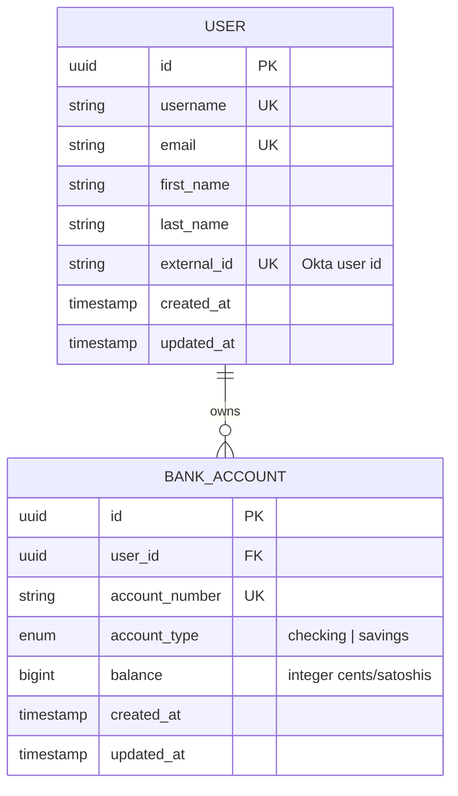

# Domain model

## Invariants

- `externalId` is taken from the verified JWT `sub`, never from the request body; one ozzo user per Okta identity.
- Email is trimmed and lower-cased; username is 3-32 chars of `[A-Za-z0-9._-]`; names are 1-100 chars.
- Account numbers are 8-17 digits (generated 12-digit numbers when omitted, retried up to 5 times on collision).
- Balances are integers (`bigint` in the domain, `BIGINT` in PostgreSQL, decimal strings on the wire). New accounts start at 0; balances are not writable through this API.
- An account can only be deleted when its balance is 0. Deleting a user cascades to accounts at the database level (no user-delete route exists yet).
- Wallets are not stored in ozzo; they are fetched from zuma and cached.
