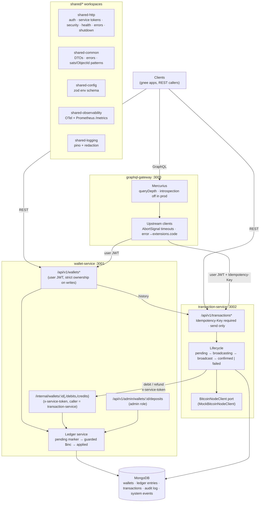
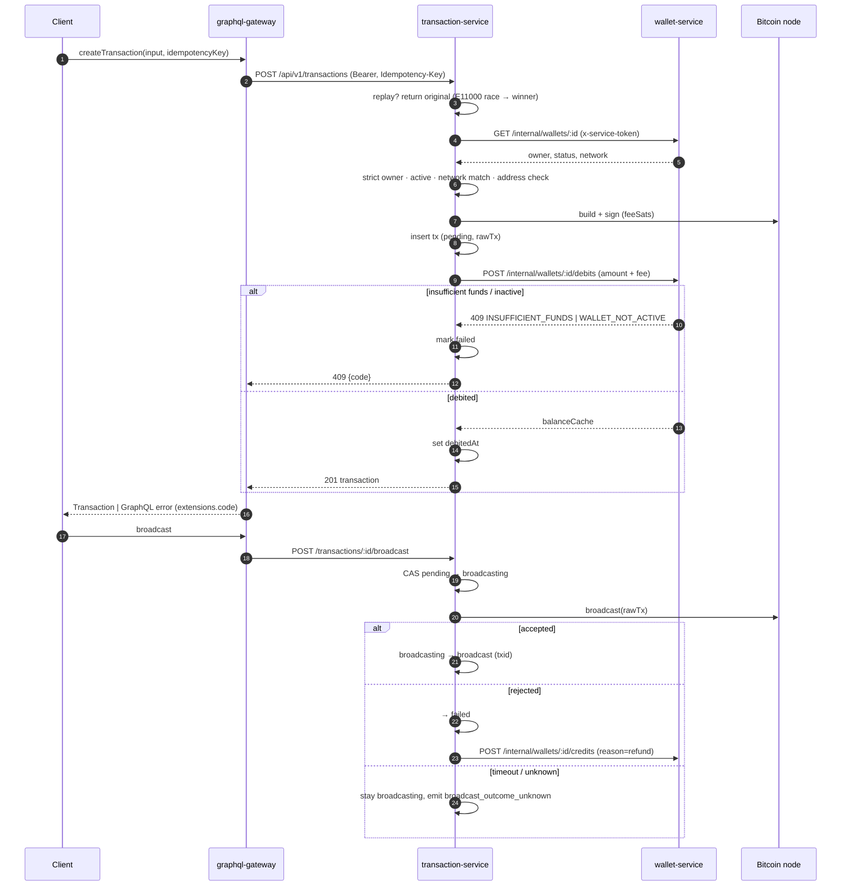
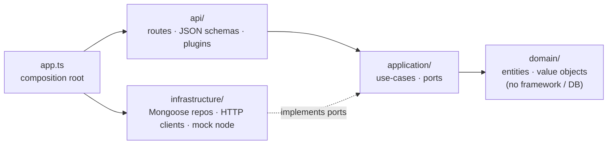
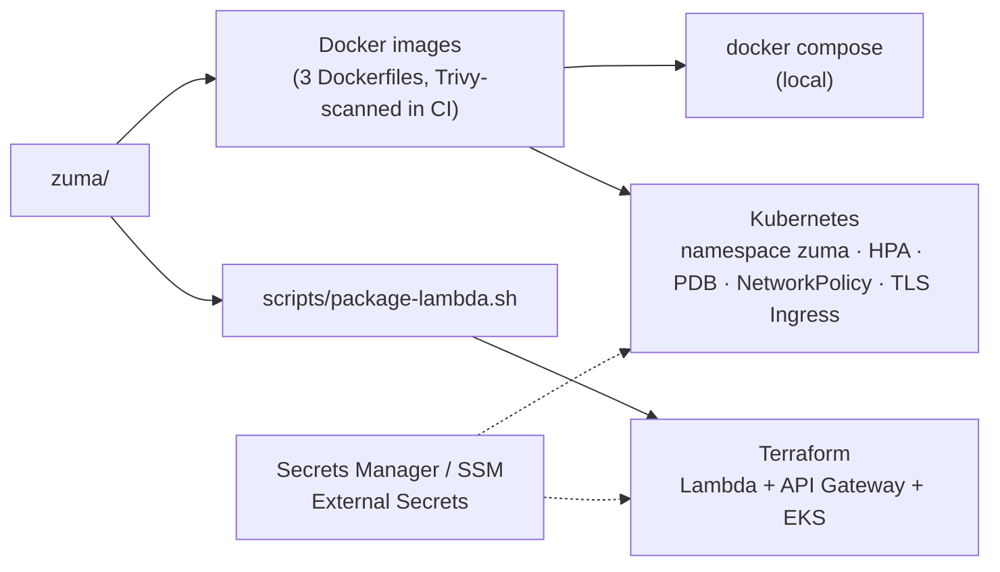

# Zuma

Backend for a Bitcoin wallet and transaction platform: an npm-workspaces monorepo of Fastify 5 services on MongoDB, with a Mercurius GraphQL gateway in front and Clean Architecture inside each service.

| Deployable | Port | Responsibility |
|---|---|---|
| `services/wallet-service` | 3001 | Wallets, balances (integer satoshis), idempotent ledger, transaction history |
| `services/transaction-service` | 3002 | Transaction creation (idempotent), validation, broadcast lifecycle, status |
| `graphql` (`graphql-gateway`) | 3003 | GraphQL composition over both services; no database access |

## Architecture



Every service and the gateway register `@zuma/shared-http` through `src/api/plugins/platform.ts`. That provides helmet, a CORS allow-list, rate limiting, body limits and timeouts, JWT auth (HS256 or OIDC/JWKS with pinned algorithms and a required audience), `/healthz` and `/readyz`, uniform `{statusCode, code, message}` errors, and graceful shutdown.

### Send flow



The full state machine and the ledger's crash-safety argument are in [docs/domain-model.md](docs/domain-model.md).

### Clean Architecture per service



## Layout

```
zuma/
  biome.json                 # lint config (Biome 2, formatter off for now)
  docker-compose.yml         # local stack: mongo + 3 services
  graphql/                   # gateway: schema/, resolvers/, clients/, tests/
  services/
    wallet-service/          # api/ application/ domain/ infrastructure/ + lambda-handler.ts
    transaction-service/
  shared/
    common/ config/ http/ logging/ observability/
  infrastructure/
    docker/                  # one Dockerfile per deployable (build context = zuma/)
    kubernetes/              # namespace, per-service manifests, mongo, NetworkPolicy, Ingress
    aws/terraform/           # EKS + wallet-service Lambda behind API Gateway
  scripts/                   # dev-up, run-tests, generate-docs, package-lambda
  docs/                      # architecture, domain model, API spec, security, testing, postman/
```

## Prerequisites

- Node.js 22 (`nvm use 22`) and npm 10
- Docker (MongoDB, or the whole stack)
- Secrets from 1Password (see below) or a git-ignored `zuma/.env` copied from `.env.example`. Required keys: `MONGO_ROOT_PASSWORD`, `JWT_SECRET` (at least 32 chars), `INTERNAL_JWT_SECRET` (at least 32 chars, different from `JWT_SECRET`), `METRICS_TOKEN` (at least 16 chars). The full environment table is in [infrastructure/README.md](infrastructure/README.md#runtime-configuration).

## Secrets and local dev (1Password)

`zuma/docker-compose.yml` contains no secrets; it reads `MONGO_ROOT_PASSWORD`, `JWT_SECRET`, `INTERNAL_JWT_SECRET` and `METRICS_TOKEN` from the environment and fails fast if one is missing. [`zuma.op.env`](zuma.op.env) maps them to `op://zuma/mongo-credentials/{username,password}`, `op://zuma/jwt-secrets/{jwt_secret,internal_jwt_secret}` and `op://zuma/metrics/metrics_token` (adjust vault/items to your org). Run from the repo root:

```zsh
# compose (op plugin run does NOT resolve op:// refs; use op run)
op run --env-file=zuma/zuma.op.env -- docker compose -f zuma/docker-compose.yml up -d --build
# tests / dev servers needing the secrets
op run --env-file=zuma/zuma.op.env -- npm test -w @zuma/wallet-service
# yone standalone
cd yone && op run --env-file=yone.op.env -- npm run dev
```

Unit tests do not need secrets. A plain git-ignored `zuma/.env` (from `.env.example`) remains a fallback only if it holds real values, not `op://` references. `./scripts/dev-up.sh` still requires that fallback `zuma/.env` file and does not yet support `op run`. CI must supply the same variables via its secret store.

## Run locally

```zsh
chmod +x scripts/*.sh               # once
npm ci
./scripts/dev-up.sh                 # MongoDB only
npm run dev -w @zuma/wallet-service
npm run dev -w @zuma/transaction-service
npm run dev -w @zuma/graphql-gateway
```

To run the whole stack in containers instead:

```zsh
./scripts/dev-up.sh --full          # docker compose up -d --build
```

Local endpoints: GraphQL at `http://localhost:3003/graphql`, and OpenAPI docs at `/docs` on each service. `/docs` is off in production unless `DOCS_ENABLED=true`.

A new wallet starts at `0` sats. Fund it in development through the admin deposit route:

```zsh
curl -sS -X POST "http://localhost:3001/api/v1/admin/wallets/$WALLET_ID/deposits" \
  -H "Authorization: Bearer $ADMIN_JWT" -H 'Content-Type: application/json' \
  -d '{"amountSats":"100000","reference":"dev-seed-1"}'
```

## Lint

```zsh
npm run lint            # biome lint .
npm run typecheck       # tsc -b across all workspaces
```

## Test

```zsh
npm test --workspaces --if-present                                   # every workspace (unit + Mongo integration)
npm test -w @zuma/transaction-service -- create-transaction.use-case.test.ts
npm test -w @zuma/wallet-service -- --testPathIgnorePatterns repository   # unit only
./scripts/run-tests.sh                                               # npm ci + all tests
```

| Layer | Where | Notes |
|---|---|---|
| Unit | `services/*/tests/*.use-case.test.ts`, `shared/http/tests`, `graphql/tests` | Ports are mocked; no Mongo or HTTP. Jest maps `@zuma/shared-*` to `src`, so no build is needed first |
| Integration | `services/*/tests/*.repository.test.ts` | Run against `mongodb-memory-server`, which downloads `mongod` and binds a local port. Skipped in sandboxed CI |
| E2E | not yet | Recommended approach is in [docs/testing-strategy.md](docs/testing-strategy.md) |

For manual API testing there's a Postman collection under [docs/postman/](docs/postman/). Create requests need an `Idempotency-Key` header and satoshi amounts.

## API testing (Postman)

[docs/postman/](docs/postman/README.md) has an end-to-end collection with 180 requests. It covers every REST route, the `/internal` service routes, the admin routes, health, metrics and docs, and every GraphQL query and mutation, plus security checks. It creates its own data. Run it against a running stack:

```zsh
make postman                                                    # repo root: zhios stack (OIDC/JWKS), secrets from root .env
bash scripts/run-postman.sh --auth-mode hs256                   # from zuma/: standalone zuma stack (HS256, zuma/.env)
node scripts/check-postman-coverage.mjs                         # offline: every route/GraphQL field covered, scripts compile
```

Pick the auth mode that matches the stack: services verify **either** HS256 **or** JWKS tokens. The README there covers importing into the Postman app, secrets, macOS networking and troubleshooting.

## Build

```zsh
npm run build                                                        # tsc -b → dist/
docker build -f infrastructure/docker/wallet-service.Dockerfile -t zuma/wallet-service:0.1.0 .
```

## Deploy



The full local stack (zuma, the gnee web SPA and a mock OIDC provider) deploys from the repo
root. Terraform is the default (`make secrets-local && make deploy`), and docker compose is the
alternative (`make compose-up && make compose-test`). See [../README.md#deploy](../README.md#deploy).
The root compose file includes `docker-compose.yml` here unchanged and layers
`../deploy/compose/zuma.override.yml` on top. That override switches user-token verification to
the mock IdP's JWKS (`JWT_ISSUER=http://localhost:8090/zuma`, `JWT_AUDIENCE=zuma-api`).

| Target | Steps |
|---|---|
| Local, full stack (recommended) | repo root: `make deploy` (Terraform) or `make compose-up` |
| Local, zuma only (HS256 tokens) | `./scripts/dev-up.sh --full` |
| Kubernetes | 1. Build and push the images with a release tag (never `:latest`). 2. Provision the secrets through External Secrets or Sealed Secrets; the `secret.yaml` files are only `CHANGE_ME` templates. 3. `kubectl apply -f infrastructure/kubernetes/namespace.yaml`, then apply the per-service directories, `mongodb/` and `networkpolicy.yaml`. |
| AWS Lambda (wallet-service) | `./scripts/package-lambda.sh`, then in `infrastructure/aws/terraform`: `op plugin run -- terraform init -input=false` and `op plugin run -- terraform plan -input=false -out=tfplan`. Review the plan, then apply. |

Operational detail (probes, NetworkPolicy, TLS, how secrets stay out of Terraform state, EKS endpoint access) is in [infrastructure/README.md](infrastructure/README.md).

## CI

[`.github/workflows/zuma-ci.yml`](../.github/workflows/zuma-ci.yml) runs: lint (Biome), build, unit tests, secret scan (gitleaks), infra lint (shellcheck, hadolint, kubeconform, `docker compose config`), terraform fmt/validate, a docker-build matrix with Trivy, and a security audit.

## Documentation

- [docs/architecture.md](docs/architecture.md): system diagram, layering, the shared HTTP platform
- [docs/domain-model.md](docs/domain-model.md): units, ledger, the transaction state machine
- [docs/api-spec.md](docs/api-spec.md): REST endpoints and the GraphQL schema
- [docs/security.md](docs/security.md): user and service auth, secrets, OWASP notes
- [docs/testing-strategy.md](docs/testing-strategy.md): testing pyramid and CI behaviour
- [infrastructure/README.md](infrastructure/README.md): runtime config, Kubernetes, AWS

## Known gaps

- Only `MockBitcoinNodeClient` exists. Production config requires `BITCOIN_ADAPTER=rpc`, which isn't implemented yet.
- There's no reconciliation worker yet for `broadcasting` transactions with an unknown outcome, debits that never completed, or failed sends that were never refunded.
- Rate limiting uses an in-memory store per replica; move it to Redis before scaling out.
- Existing wallet documents need migrating from `balanceCache` (string) to `balanceSats` (number).
