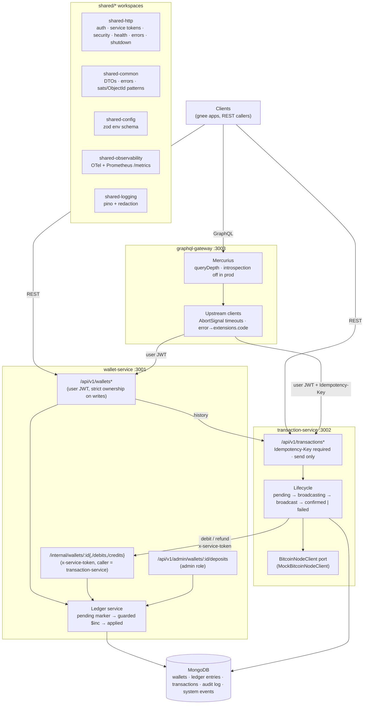
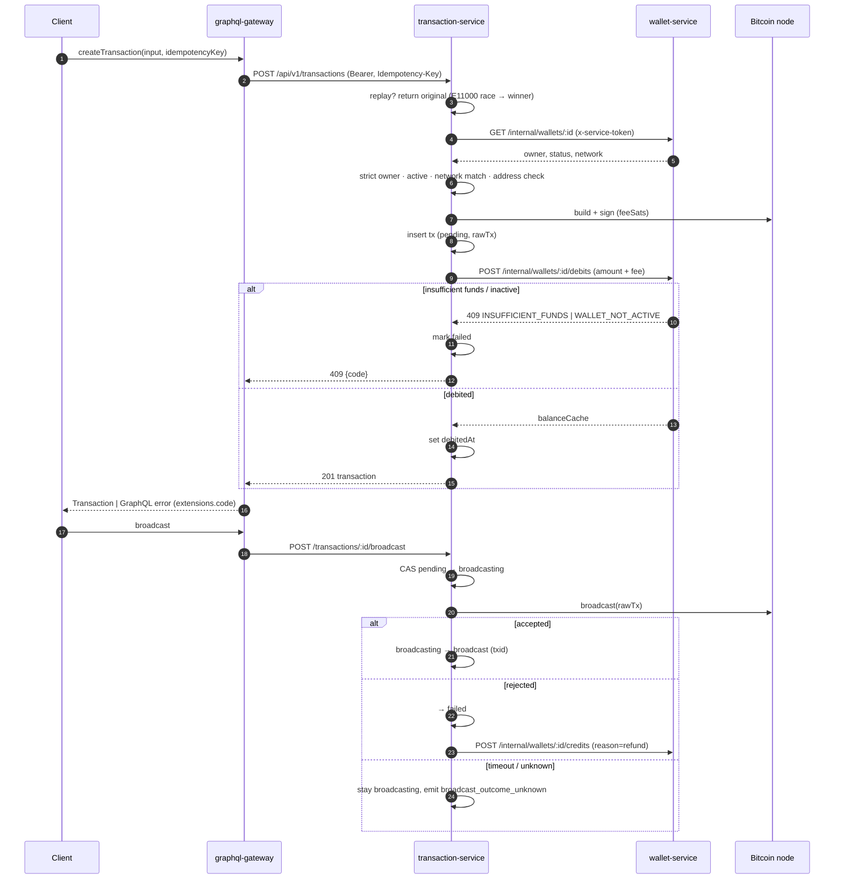
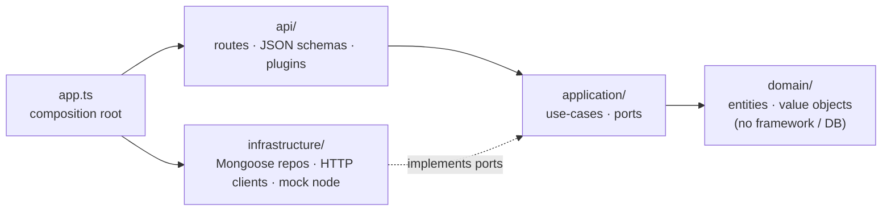
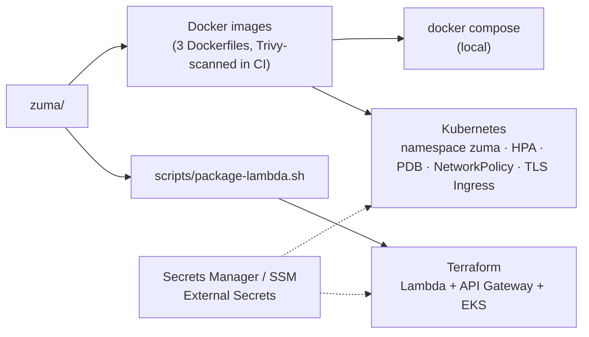

# Zuma

Backend for a Bitcoin wallet and transaction platform: an npm-workspaces monorepo of Fastify 5 services on MongoDB, with a Mercurius GraphQL gateway in front and Clean Architecture inside each service.

| Deployable | Port | Responsibility |
|---|---|---|
| `services/wallet-service` | 3001 | Wallets, balances (integer satoshis), idempotent ledger, transaction history |
| `services/transaction-service` | 3002 | Transaction creation (idempotent), validation, broadcast lifecycle, status |
| `graphql` (`graphql-gateway`) | 3003 | GraphQL composition over both services; no database access |

## Architecture



Every service and the gateway register `@zuma/shared-http` through `src/api/plugins/platform.ts`. That provides helmet, a CORS allow-list, rate limiting, body limits and timeouts, JWT auth (HS256 or OIDC/JWKS with pinned algorithms and a required audience), `/healthz` and `/readyz`, uniform `{statusCode, code, message}` errors, and graceful shutdown.

### Send flow



The full state machine and the ledger's crash-safety argument are in [docs/domain-model.md](docs/domain-model.md).

### Clean Architecture per service



## Layout

```
zuma/
  biome.json                 # lint config (Biome 2, formatter off for now)
  docker-compose.yml         # local stack: mongo + 3 services
  graphql/                   # gateway: schema/, resolvers/, clients/, tests/
  services/
    wallet-service/          # api/ application/ domain/ infrastructure/ + lambda-handler.ts
    transaction-service/
  shared/
    common/ config/ http/ logging/ observability/
  infrastructure/
    docker/                  # one Dockerfile per deployable (build context = zuma/)
    kubernetes/              # namespace, per-service manifests, mongo, NetworkPolicy, Ingress
    aws/terraform/           # EKS + wallet-service Lambda behind API Gateway
  scripts/                   # dev-up, run-tests, generate-docs, package-lambda
  docs/                      # architecture, domain model, API spec, security, testing, postman/
```

## Prerequisites

- Node.js 22 (`nvm use 22`) and npm 10
- Docker (MongoDB, or the whole stack)
- Secrets from 1Password (see below) or a git-ignored `zuma/.env` copied from `.env.example`. Required keys: `MONGO_ROOT_PASSWORD`, `JWT_SECRET` (at least 32 chars), `INTERNAL_JWT_SECRET` (at least 32 chars, different from `JWT_SECRET`), `METRICS_TOKEN` (at least 16 chars). The full environment table is in [infrastructure/README.md](infrastructure/README.md#runtime-configuration).

## Secrets and local dev (1Password)

`zuma/docker-compose.yml` contains no secrets; it reads `MONGO_ROOT_PASSWORD`, `JWT_SECRET`, `INTERNAL_JWT_SECRET` and `METRICS_TOKEN` from the environment and fails fast if one is missing. [`zuma.op.env`](zuma.op.env) maps them to `op://zuma/mongo-credentials/{username,password}`, `op://zuma/jwt-secrets/{jwt_secret,internal_jwt_secret}` and `op://zuma/metrics/metrics_token` (adjust vault/items to your org). Run from the repo root:

```zsh
# compose (op plugin run does NOT resolve op:// refs; use op run)
op run --env-file=zuma/zuma.op.env -- docker compose -f zuma/docker-compose.yml up -d --build
# tests / dev servers needing the secrets
op run --env-file=zuma/zuma.op.env -- npm test -w @zuma/wallet-service
# yone standalone
cd yone && op run --env-file=yone.op.env -- npm run dev
```

Unit tests do not need secrets. A plain git-ignored `zuma/.env` (from `.env.example`) remains a fallback only if it holds real values, not `op://` references. `./scripts/dev-up.sh` still requires that fallback `zuma/.env` file and does not yet support `op run`. CI must supply the same variables via its secret store.

## Run locally

```zsh
chmod +x scripts/*.sh               # once
npm ci
./scripts/dev-up.sh                 # MongoDB only
npm run dev -w @zuma/wallet-service
npm run dev -w @zuma/transaction-service
npm run dev -w @zuma/graphql-gateway
```

To run the whole stack in containers instead:

```zsh
./scripts/dev-up.sh --full          # docker compose up -d --build
```

Local endpoints: GraphQL at `http://localhost:3003/graphql`, and OpenAPI docs at `/docs` on each service. `/docs` is off in production unless `DOCS_ENABLED=true`.

A new wallet starts at `0` sats. Fund it in development through the admin deposit route:

```zsh
curl -sS -X POST "http://localhost:3001/api/v1/admin/wallets/$WALLET_ID/deposits" \
  -H "Authorization: Bearer $ADMIN_JWT" -H 'Content-Type: application/json' \
  -d '{"amountSats":"100000","reference":"dev-seed-1"}'
```

## Lint

```zsh
npm run lint            # biome lint .
npm run typecheck       # tsc -b across all workspaces
```

## Test

```zsh
npm test --workspaces --if-present                                   # every workspace (unit + Mongo integration)
npm test -w @zuma/transaction-service -- create-transaction.use-case.test.ts
npm test -w @zuma/wallet-service -- --testPathIgnorePatterns repository   # unit only
./scripts/run-tests.sh                                               # npm ci + all tests
```

| Layer | Where | Notes |
|---|---|---|
| Unit | `services/*/tests/*.use-case.test.ts`, `shared/http/tests`, `graphql/tests` | Ports are mocked; no Mongo or HTTP. Jest maps `@zuma/shared-*` to `src`, so no build is needed first |
| Integration | `services/*/tests/*.repository.test.ts` | Run against `mongodb-memory-server`, which downloads `mongod` and binds a local port. Skipped in sandboxed CI |
| E2E | not yet | Recommended approach is in [docs/testing-strategy.md](docs/testing-strategy.md) |

For manual API testing there's a Postman collection under [docs/postman/](docs/postman/). Create requests need an `Idempotency-Key` header and satoshi amounts.

## API testing (Postman)

[docs/postman/](docs/postman/README.md) has an end-to-end collection with 180 requests. It covers every REST route, the `/internal` service routes, the admin routes, health, metrics and docs, and every GraphQL query and mutation, plus security checks. It creates its own data. Run it against a running stack:

```zsh
make postman                                                    # repo root: zhios stack (OIDC/JWKS), secrets from root .env
bash scripts/run-postman.sh --auth-mode hs256                   # from zuma/: standalone zuma stack (HS256, zuma/.env)
node scripts/check-postman-coverage.mjs                         # offline: every route/GraphQL field covered, scripts compile
```

Pick the auth mode that matches the stack: services verify **either** HS256 **or** JWKS tokens. The README there covers importing into the Postman app, secrets, macOS networking and troubleshooting.

## Build

```zsh
npm run build                                                        # tsc -b → dist/
docker build -f infrastructure/docker/wallet-service.Dockerfile -t zuma/wallet-service:0.1.0 .
```

## Deploy



The full local stack (zuma, the gnee web SPA and a mock OIDC provider) deploys from the repo
root. Terraform is the default (`make secrets-local && make deploy`), and docker compose is the
alternative (`make compose-up && make compose-test`). See [../README.md#deploy](../README.md#deploy).
The root compose file includes `docker-compose.yml` here unchanged and layers
`../deploy/compose/zuma.override.yml` on top. That override switches user-token verification to
the mock IdP's JWKS (`JWT_ISSUER=http://localhost:8090/zuma`, `JWT_AUDIENCE=zuma-api`).

| Target | Steps |
|---|---|
| Local, full stack (recommended) | repo root: `make deploy` (Terraform) or `make compose-up` |
| Local, zuma only (HS256 tokens) | `./scripts/dev-up.sh --full` |
| Kubernetes | 1. Build and push the images with a release tag (never `:latest`). 2. Provision the secrets through External Secrets or Sealed Secrets; the `secret.yaml` files are only `CHANGE_ME` templates. 3. `kubectl apply -f infrastructure/kubernetes/namespace.yaml`, then apply the per-service directories, `mongodb/` and `networkpolicy.yaml`. |
| AWS Lambda (wallet-service) | `./scripts/package-lambda.sh`, then in `infrastructure/aws/terraform`: `op plugin run -- terraform init -input=false` and `op plugin run -- terraform plan -input=false -out=tfplan`. Review the plan, then apply. |

Operational detail (probes, NetworkPolicy, TLS, how secrets stay out of Terraform state, EKS endpoint access) is in [infrastructure/README.md](infrastructure/README.md).

## Observability: Pino Logging and New Relic APM

All three services use `@zuma/shared-logging` (pino) for structured logging and optionally the New Relic Node agent for APM. Defaults are safe: JSON on stdout, file logging off, APM off.

### Installation

Pino logging and New Relic APM are pre-configured. Install dependencies:

```bash
npm install
```

This installs: `pino`, `pino-pretty`, `pino-roll` (file rotation), and `newrelic`.

### Configuration

All variables are defined in `shared/config/src/env-schema.ts` and validated at startup.

| Variable | Default | Purpose |
|---|---|---|
| `LOG_LEVEL` | `info` | `fatal`, `error`, `warn`, `info`, `debug`, `trace` |
| `LOG_TO_FILE` | false (true in prod) | Write rotating files via `pino-roll` (daily rotation) |
| `LOG_FILE_PATH` | `./logs` | Directory for log files (creates if missing) |
| `LOG_FILE_MAX_SIZE` | `10485760` (10MB) | Bytes per file before rotating |
| `LOG_FILE_ROTATE_DAYS` | `7` | Days of logs to retain |
| `NEW_RELIC_ENABLED` | `false` | Start the New Relic APM agent |
| `NEW_RELIC_LICENSE_KEY` | unset | **Required if NEW_RELIC_ENABLED=true** |
| `NEW_RELIC_APP_NAME` | service name | Auto-set: wallet-service, transaction-service, graphql-gateway |
| `NEW_RELIC_LOG_LEVEL` | `info` | New Relic agent's own log level |
| `NEWRELIC_LOGS_ENABLED` | `false` | Forward logs to New Relic Logs API (requires license key) |
| `NEWRELIC_LOGS_ENDPOINT` | `https://log-api.newrelic.com/log/v1` | New Relic Logs API endpoint |

### Local Development (Pretty Logs)

Run with debug logging and pretty-printed output:

```bash
# Single service
LOG_LEVEL=debug npm run dev -w @zuma/wallet-service

# Example output:
# [12:34:56.789] INFO (zuma-wallet-service/12345): Server listening
#   service: "wallet-service"
#   port: 3001
#   env: "development"
```

### Local Development with File Logging

Enable file logging to disk:

```bash
# File logs go to ./logs/
LOG_TO_FILE=true npm run dev

# View logs
tail -f logs/wallet-service.*.log
tail -f logs/transaction-service.*.log
tail -f logs/graphql-gateway.*.log
```

### Using 1Password (Recommended)

Inject secrets from 1Password CLI:

```bash
# Edit zuma/zuma.op.env (already configured with paths to vault items)
# Then run with full env including New Relic license key
NEW_RELIC_ENABLED=true LOG_TO_FILE=true op run --env-file=zuma/zuma.op.env -- npm run dev -w @zuma/wallet-service
```

### Output Formats

**Development** (`NODE_ENV=development`):
- Pretty-printed console output with colors
- Easier to read during development

**Production** (`NODE_ENV=production`):
- JSON structured logs to stdout
- Each line is a complete JSON object
- Machine-parseable for log aggregation systems
- File logs: JSON format to `./logs/<service>.<date>.log`

### Log Files and Rotation

**Location**: `./logs/` directory (auto-created)

**File naming**:
```
wallet-service.2026-11-12.1.log      ← Latest
wallet-service.2026-11-12.2.log
wallet-service.2026-11-11.1.log      ← Yesterday
wallet-service.2026-11-10.1.log
wallet-service.2026-11-03.1.log      ← 7 days back (auto-deleted)
```

**Rotation triggers**:
- Daily at midnight (UTC)
- Immediately if file exceeds 10MB
- Old files deleted after 7 days

### Sensitive Data Redaction

The following fields are automatically redacted in all logs (never sent to New Relic or files):

```javascript
// Redacted patterns:
"password", "token", "secret", "apiKey", "Authorization", "x-service-token",
"creditCard", "cvv", "accountNumber", "privateKey"

// Example:
{
  "Authorization": "Bearer [redacted]",
  "password": "[redacted]",
  "x-service-token": "[redacted]"
}
```

### New Relic APM Setup

#### Get a License Key

1. Sign up at https://newrelic.com (free tier available)
2. Go to API Keys: https://one.newrelic.com/api-keys
3. Create or copy your **INGEST** license key (32 characters)

#### Configure Environment

```bash
# Option 1: Add to .env file
NEW_RELIC_ENABLED=true
NEW_RELIC_LICENSE_KEY=<your-license-key>
NEW_RELIC_LOGS_ENABLED=true

# Option 2: Via 1Password (recommended for production)
# Add to zuma/zuma.op.env:
# NEW_RELIC_LICENSE_KEY=op://zuma/newrelic/license-key

# Option 3: Docker/ECS/EKS
# Inject via secrets manager (see infrastructure/README.md)
```

#### Start Services with APM

```bash
# Local testing
NEW_RELIC_ENABLED=true \
NEW_RELIC_LICENSE_KEY=<your-key> \
npm run dev

# Or with 1Password
op run --env-file=zuma/zuma.op.env -- npm run dev
```

#### Verify APM is Running

Check startup logs:
```
INFO (wallet-service): New Relic agent initialized
  license_key_set: true
  distributed_tracing: true
```

Then visit New Relic UI (after 1-2 minutes of traffic):
- **APM Dashboard**: https://one.newrelic.com/nr1-core/apm-sql-databases/home
- **Logs**: https://one.newrelic.com/logs
- **Distributed Traces**: https://one.newrelic.com/distributed-tracing

### What Gets Monitored

**Automatic (New Relic Agent)**:
- ✅ HTTP requests/responses (Fastify routes)
- ✅ Database queries (Mongoose/MongoDB)
- ✅ External HTTP calls (axios, native fetch)
- ✅ Error rates and stack traces
- ✅ Response times and throughput

**Custom Metrics** (wallet-service, transaction-service):
- ✅ Ledger operations
- ✅ Transaction lifecycle events
- ✅ Service-to-service calls

**Distributed Tracing**:
- ✅ Cross-service request flow
- ✅ Latency tracking end-to-end
- ✅ Error propagation tracking

### Testing Logging

```bash
# 1. Start all services locally with file logging
LOG_TO_FILE=true npm run dev

# 2. In another terminal, check log files are created
ls -lh logs/

# 3. View logs in real-time (from any service)
tail -f logs/wallet-service.*.log | jq .

# 4. Generate some traffic
curl -H "Authorization: Bearer <token>" http://localhost:3001/api/v1/wallets

# 5. Verify log entries appear
grep "GET /api/v1/wallets" logs/wallet-service.*.log

# 6. Test with New Relic (optional)
NEW_RELIC_ENABLED=true NEW_RELIC_LICENSE_KEY=<key> npm run dev
# Wait 1-2 minutes, then check New Relic UI
```

### Troubleshooting

#### Logs not appearing in files

```bash
# Check LOG_TO_FILE is set
echo $LOG_TO_FILE

# Check directory exists and is writable
ls -la logs/
chmod 755 logs/

# Check disk space
df -h logs/
```

#### New Relic not connecting

```bash
# Verify license key is set and valid
echo $NEW_RELIC_LICENSE_KEY

# Check agent started (look for startup logs)
npm run dev 2>&1 | grep -i "new relic"

# Verify network access to New Relic
curl -I https://api.newrelic.com/

# Enable agent debug logging
NEW_RELIC_LOG_LEVEL=debug npm run dev
```

#### High log volume in production

```bash
# Reduce log level
LOG_LEVEL=warn npm run dev

# Disable New Relic log forwarding if not needed
NEWRELIC_LOGS_ENABLED=false npm run dev
```

#### Log files not rotating

```bash
# Check cron is running (if using systemd timer)
systemctl status zuma-logrotate

# Manual rotation
find logs/ -name "*.log" -mtime +7 -delete

# Or use logrotate config (see infrastructure/logrotate.conf)
```

### Docker Deployment

Logs in Docker go to stdout (captured by docker logs):

```bash
# Start with file logging
docker-compose up -e LOG_TO_FILE=true

# View container logs
docker compose logs -f wallet-service
docker compose logs -f transaction-service
docker compose logs -f graphql

# File logs also appear in container at /app/logs/
docker exec <container-id> tail -f /app/logs/wallet-service.*.log
```

### ECS Deployment

Logs are sent to CloudWatch Logs:

```bash
# View ECS task logs
aws logs tail /ecs/zuma-wallet-service --follow

# Search logs
aws logs filter-log-events \
  --log-group-name /ecs/zuma-wallet-service \
  --filter-pattern "ERROR"
```

### EKS Deployment

Logs are captured by kubectl:

```bash
# View pod logs
kubectl logs -f -n zuma wallet-service-<pod-id>

# Follow all wallet-service pods
kubectl logs -f -n zuma -l app=wallet-service

# Search logs
kubectl logs -n zuma -l app=wallet-service | grep ERROR
```

### New Relic NRQL Queries

Example queries to monitor your services:

```sql
-- Average response time per endpoint
SELECT average(duration) FROM Transaction 
WHERE service.name LIKE 'zuma-%'
FACET http.request.url

-- Transaction error rate
SELECT percentage(count(*), WHERE error = true) 
FROM Transaction
WHERE service.name LIKE 'zuma-%'
SINCE 1 hour ago

-- Database operation metrics
SELECT average(duration) FROM Metric
WHERE metric.name LIKE 'Datastore/statement/MongoDB/%'
FACET metric.name
SINCE 1 hour ago

-- View application logs
SELECT * FROM Log
WHERE service.name = 'zuma-wallet-service'
LIMIT 100
```

### Production Best Practices

1. **Always use 1Password for secrets**: Never hardcode license keys
2. **Enable New Relic Logs**: Forward application logs for centralized monitoring
3. **Monitor file disk usage**: Ensure `/logs` partition has adequate space
4. **Rotate logs regularly**: Set up cron job or use systemd timer
5. **Set appropriate log levels**: Use `warn` or `error` in production
6. **Test log queries**: Verify your monitoring alerts work before production
7. **Keep licenses fresh**: Renew New Relic subscriptions before expiration

## CI

[`.github/workflows/zuma-ci.yml`](../.github/workflows/zuma-ci.yml) runs: lint (Biome), build, unit tests, secret scan (gitleaks), infra lint (shellcheck, hadolint, kubeconform, `docker compose config`), terraform fmt/validate, a docker-build matrix with Trivy, and a security audit.

## Documentation

- [docs/architecture.md](docs/architecture.md): system diagram, layering, the shared HTTP platform
- [docs/domain-model.md](docs/domain-model.md): units, ledger, the transaction state machine
- [docs/api-spec.md](docs/api-spec.md): REST endpoints and the GraphQL schema
- [docs/security.md](docs/security.md): user and service auth, secrets, OWASP notes
- [docs/testing-strategy.md](docs/testing-strategy.md): testing pyramid and CI behaviour
- [infrastructure/README.md](infrastructure/README.md): runtime config, Kubernetes, AWS

## Known gaps

- Only `MockBitcoinNodeClient` exists. Production config requires `BITCOIN_ADAPTER=rpc`, which isn't implemented yet.
- There's no reconciliation worker yet for `broadcasting` transactions with an unknown outcome, debits that never completed, or failed sends that were never refunded.
- Rate limiting uses an in-memory store per replica; move it to Redis before scaling out.
- Existing wallet documents need migrating from `balanceCache` (string) to `balanceSats` (number).
