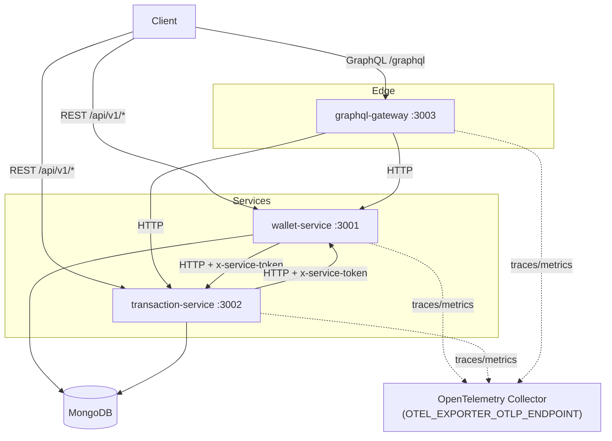

# Architecture

## System overview

- `graphql-gateway` has no direct MongoDB dependency — it is a pure composition layer over `wallet-service` and `transaction-service` HTTP clients (`WalletServiceClient`, `TransactionServiceClient`).
- Clients may call either the GraphQL gateway or the REST APIs directly; both paths are supported and backed by the same use-cases.
- `wallet-service` calls `transaction-service` directly (`TRANSACTION_SERVICE_URL`) to serve `GET /wallets/:id/transactions`; `transaction-service` calls `wallet-service` (`WALLET_SERVICE_URL`) to validate/debit wallets during transaction creation.
- Service-to-service calls authenticate with a short-lived `x-service-token` (HS256, `INTERNAL_JWT_SECRET`, audience = callee `SERVICE_NAME`) verified by `app.requireService`; see `docs/security.md`.
- Each service registers `@zuma/shared-observability`'s `observabilityPlugin`, and serves Prometheus `/metrics` (token-gated in production). Tracing starts only when `OTEL_EXPORTER_OTLP_ENDPOINT` is set: each entrypoint's first import is `./otel`, which calls `startOtelFromEnv` before Fastify/Mongoose load so auto-instrumentation can patch them; graceful shutdown flushes spans.

## Clean Architecture layering

Each service (`wallet-service`, `transaction-service`) is organized into four layers under `src/`:

| Layer | Responsibility | Depends on |
|---|---|---|
| `api/` | Fastify plugins, routes, JSON-schema request/response validation | `application/` |
| `application/` | Use-cases (one class per operation), orchestrate domain + ports | `domain/` |
| `domain/` | Entities and value objects — plain TypeScript, no framework/DB imports | nothing |
| `infrastructure/` | Adapters: Mongoose repositories, HTTP clients, mock chain clients | `domain/` (implements its ports) |

The composition root (`app.ts`) wires concrete `infrastructure/` adapters into `application/` use-cases, which are then injected into `api/routes/*.routes.ts`.

This layering is used for:

- **Testability** — use-cases are unit-tested with mocked repository/client ports (no Fastify, no Mongo); repositories are integration-tested against `mongodb-memory-server` without booting HTTP.
- **Independent scalability** — `wallet-service` and `transaction-service` are separate deployables (separate Dockerfiles, k8s Deployments, HPAs) and can scale independently based on their own load profile.
- **Swappable infrastructure** — e.g. `MockBitcoinNodeClient` and `MockAddressGenerator` are drop-in stand-ins for a real Bitcoin node / HSM-backed signer; swapping them for production implementations requires no change to `domain/` or `application/`.

## Shared HTTP platform (`@zuma/shared-http`)

Cross-cutting HTTP concerns are a shared workspace rather than per-service copies:

| Export | Purpose |
|---|---|
| `authPlugin`, `toActor` | User JWT verification (`requireAuth`, `requireRole`); HS256 or JWKS with pinned algorithms |
| `serviceAuthPlugin`, `createServiceTokenSigner`, `verifyServiceToken`, `allowServiceCallers` | Service-to-service auth (`requireService`, `request.serviceCaller`) |
| `securityPlugin` | Helmet, CORS allow-list, rate limiting |
| `healthPlugin` | `/healthz` liveness, `/readyz` readiness from injected checks (services pass a Mongo ping; the gateway pings both upstreams) |
| `buildServerOptions` | Fastify `bodyLimit` / timeouts / `trustProxy` |
| `errorHandler` | Uniform `{ statusCode, code, message }` errors, opaque 5xx |
| `registerGracefulShutdown` | SIGTERM/SIGINT → `app.close()` → cleanup hooks (Mongo, OTel) with a hard `SHUTDOWN_TIMEOUT_MS` deadline |

Services register these through `src/api/plugins/platform.ts` (`registerPlatformPlugins`) before their routes.
