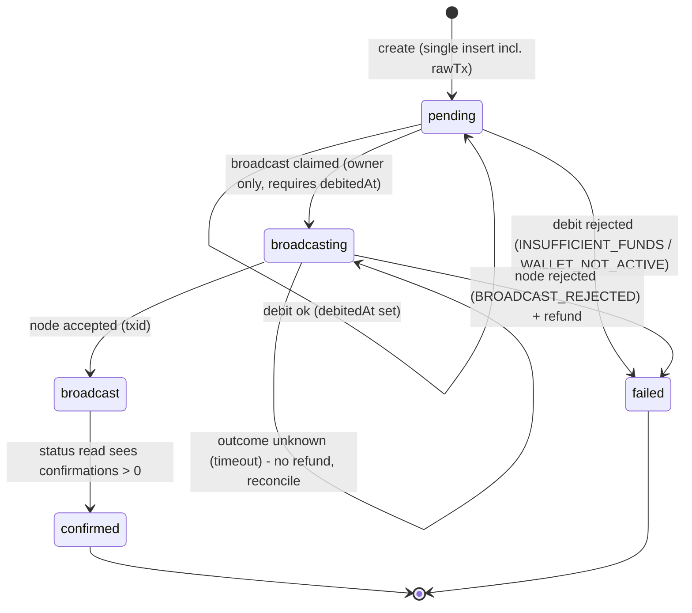

# Domain Model

## Units

- **All money is integer satoshis.** Amounts travel on the wire as decimal strings (`SATS_AMOUNT_PATTERN` `^[1-9][0-9]{0,15}$` for amounts, `SATS_BALANCE_PATTERN` `^(0|[1-9][0-9]{0,15})$` for balances) and are held internally as JavaScript `number` — exact, because the max supply (2.1 × 10^15 sats) is below `Number.MAX_SAFE_INTEGER` (≈ 9.007 × 10^15). Every parse checks `Number.isSafeInteger` and caps at max supply. BTC decimals (`"0.001"`) are rejected.
- **Fee rate** is an integer in sat/vB, `1..10000`, a decimal string on the wire.
- A send debits **amount + fee** (`feeSats`, computed by the node's build step) from the wallet.

## Entities

### Wallet (`services/wallet-service/src/domain/entities/wallet.entity.ts`)

| Field | Type | Notes |
|---|---|---|
| `id` | `string` | Mongo ObjectId (24 hex) |
| `label` | `string` | User-facing name |
| `address` | `string` | Bitcoin address, assigned by `AddressGenerator` port on creation |
| `network` | `WalletNetwork` | `mainnet` \| `testnet` \| `regtest` |
| `type` | `WalletKind` | `hot` \| `cold` \| `custodial` \| `non-custodial` |
| `balanceSats` | `number` | **Authoritative** balance in integer sats; changed only by ledger movements (guarded `$inc`). Exposed on the API as `balanceCache` (satoshi string) for compatibility |
| `metadata` | `Record<string, unknown>` | Arbitrary user-supplied data |
| `ownerUserId` | `string` | Owning user; the only actor allowed to write |
| `status` | `WalletLifecycleStatus` | `active` \| `suspended` \| `archived` — only `active` wallets can send or be debited; credits (refunds/deposits) are accepted in any status so funds are never lost |
| `createdAt` / `updatedAt` | `Date` | |

Persistence-only field: `pendingLedgerIds: string[]` — ledger entry ids whose `$inc` has landed but not yet been acknowledged (see *Balance movements*).

### LedgerEntry (`services/wallet-service/src/domain/entities/ledger-entry.entity.ts`)

Append-only audit trail of every balance movement, collection `ledgerentries`.

| Field | Type | Notes |
|---|---|---|
| `id` | `string` | |
| `walletId` | `string` | |
| `transactionId` | `string` | transaction-service tx id for `send`/`refund`; the external `reference` for `deposit` |
| `kind` | `'debit' \| 'credit'` | |
| `reason` | `'send' \| 'refund' \| 'deposit'` | |
| `amountSats` | `number` | Positive safe integer |
| `state` | `'pending' \| 'applied'` | |
| `balanceAfterSats` | `number \| null` | Balance right after applying; returned verbatim on idempotent replay |
| `createdAt` | `Date` | |

Unique index **`{transactionId, kind, reason}`** — exactly one movement per transaction/direction/reason, which is what makes every debit/credit idempotent.

### Transaction (`services/transaction-service/src/domain/entities/transaction.entity.ts`)

| Field | Type | Notes |
|---|---|---|
| `id` | `string` | |
| `walletId` | `string` | FK to `Wallet.id` |
| `ownerUserId` | `string` | |
| `idempotencyKey` | `string \| null` | Required on create; unique per `ownerUserId` |
| `txid` | `string \| null` | On-chain id, set once broadcast |
| `type` | `TransactionKind` | `send` \| `receive` \| `internal-transfer`; the API only creates `send` |
| `amount` | `string` | Satoshis |
| `feeRate` | `string` | sat/vB |
| `feeSats` | `string` | Total fee in satoshis |
| `destinationAddress` | `string` | Validated against the wallet's network |
| `status` | `TransactionLifecycleStatus` | see lifecycle below |
| `failureReason` | `string \| null` | e.g. `INSUFFICIENT_FUNDS`, `WALLET_NOT_ACTIVE`, `BROADCAST_REJECTED` |
| `confirmations` | `number` | Persisted at confirmation; live count served by the status endpoint |
| `rawTx` | `string \| null` | Signed tx, written in the same insert as the record; never returned by the API, redacted from logs (see [security.md](./security.md)) |
| `debitedAt` | `Date \| null` | Wallet debited (funds reserved); broadcast requires it |
| `refundedAt` | `Date \| null` | Refund credited after a failed broadcast |
| `broadcastAt` | `Date \| null` | |
| `createdAt` / `updatedAt` | `Date` | |

### AuditLog (`services/transaction-service/src/domain/entities/audit-log.entity.ts`)

Immutable record of a sensitive or state-changing action (`transaction.created`, `transaction.debit_rejected`, `transaction.broadcast`, `transaction.broadcast_failed`).

| Field | Type |
|---|---|
| `id` | `string` |
| `actorUserId` | `string` |
| `action` | `string` |
| `entityType` | `string` |
| `entityId` | `string` |
| `metadata` | `Record<string, unknown>` |
| `createdAt` | `Date` |

### SystemEvent (`services/transaction-service/src/domain/entities/system-event.entity.ts`)

Internal system events (outbox candidates, reconciliation signals). Emitted by broadcast: `transaction.broadcast`, `transaction.broadcast_failed`, `transaction.broadcast_outcome_unknown`, `transaction.broadcast_state_lost`, `wallet.refund_rejected`, `wallet.refund_pending`.

| Field | Type |
|---|---|
| `id` | `string` |
| `eventType` | `string` |
| `payload` | `Record<string, unknown>` |
| `createdAt` | `Date` |

## Value objects

| Value object | Values | Owner |
|---|---|---|
| `WalletNetwork` | `mainnet` \| `testnet` \| `regtest` | wallet-service |
| `WalletKind` | `hot` \| `cold` \| `custodial` \| `non-custodial` | wallet-service |
| `WalletLifecycleStatus` | `active` \| `suspended` \| `archived` | wallet-service |
| Satoshi (`satoshi.ts`) | positive safe integer ≤ 2.1e15 | both |
| Bitcoin address (`bitcoin-address.ts`) | network-aware; bech32/bech32m with full checksum + witness checks, base58 shape + version prefix (no base58check checksum) | transaction-service |
| `TransactionKind` | `send` \| `receive` \| `internal-transfer` | transaction-service |
| `TransactionLifecycleStatus` | `pending` \| `broadcasting` \| `broadcast` \| `confirmed` \| `failed` | transaction-service |

## Transaction lifecycle

Every transition is an atomic compare-and-swap on `status` (`TransactionRepositoryPort.transition`); there is no unguarded update.

- **Unknown broadcast outcome** (transport error, not a definitive `BroadcastRejectedError`): the tx stays `broadcasting` and is **not** refunded, because the coins may already be on-chain. A `transaction.broadcast_outcome_unknown` event flags it for reconciliation.
- **GET status** never writes except the `broadcast → confirmed` CAS; live confirmation counts are returned without being persisted.
- **Debit transport failure**: the tx stays `pending` with `debitedAt = null`. Replaying the same `Idempotency-Key` resumes the (idempotent) debit; broadcast refuses unfunded transactions.

## Balance movements (wallet-service)

MongoDB multi-document transactions need a replica set; docker-compose runs one but the k8s StatefulSet and test harness don't. So movements use the two-phase *pending marker* pattern, which works on a standalone `mongod` and is safe to crash after any step:

1. Insert `LedgerEntry{state:'pending'}`. A duplicate key (E11000) on the unique index is a replay: return the stored result if `applied`, resume if `pending`, `409 IDEMPOTENCY_CONFLICT` if the wallet or amount differs.
2. One guarded `findOneAndUpdate({_id, pendingLedgerIds: {$ne: entryId}, status:'active'¹, balanceSats: {$gte: amt}¹}, {$inc: {balanceSats: ±amt}, $push: {pendingLedgerIds: entryId}})`. There is no read-then-write. The `$ne` / `$push` pair makes the `$inc` apply at most once per entry. (¹ debits only.)
3. Mark the entry `applied` with `balanceAfterSats` (an upsert, so the audit row survives a racing compensation).
4. `$pull` the entry id from `pendingLedgerIds`.

If the guard in step 2 rejects the update, a read finds the cause: `404` not found, `409 WALLET_NOT_ACTIVE`, or `409 INSUFFICIENT_FUNDS`. The pending entry is then deleted as compensation, unless a concurrent attempt already finished it, in which case the result is returned. A refund is only accepted against an **applied** `debit/send` entry for the same wallet and amount, so a refund can never create funds.

## Relationships and aggregate boundaries

- **Wallet 1 → N Transaction** via `Transaction.walletId`. These are separate aggregates in separate services, each with its own MongoDB database, and there is no shared transactional boundary.
- **Wallet 1 → N LedgerEntry**. The ledger and the balance live in wallet-service, the single owner of balances.
- Cross-service consistency uses idempotent synchronous calls over wallet-service's service-only `/internal` API, authenticated with a short-lived `x-service-token`. transaction-service reads the wallet summary and does its **own explicit** ownership/status/network check. It then debits with `transactionId` as the idempotency key and refunds the same way. wallet-service still calls transaction-service for history.
- `AuditLog` and `SystemEvent` are append-only aggregates within transaction-service. They reference other entities loosely, not through foreign keys.
