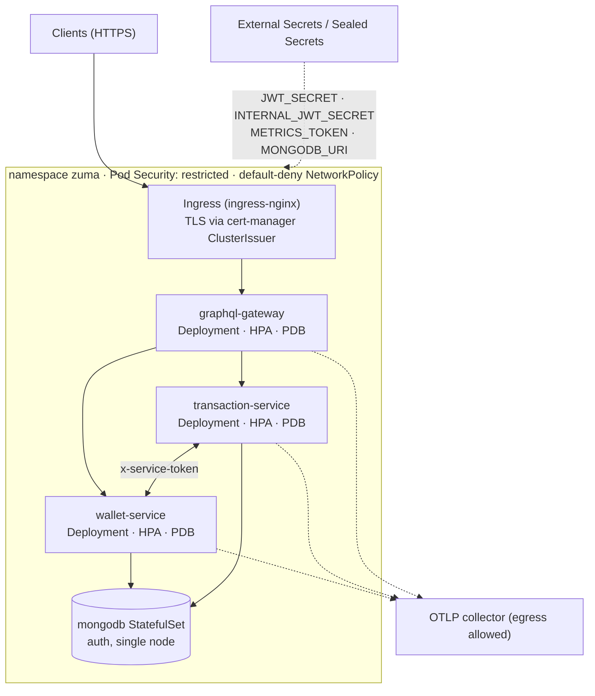
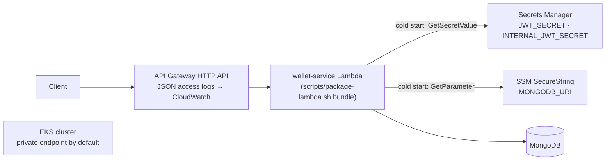

# zuma infrastructure

## Kubernetes topology



## AWS topology (Terraform)



No secret values are stored in Terraform state: only ARNs and parameter names are passed in, and the Lambda resolves the values at runtime.

| Path | Purpose |
|---|---|
| `docker/*.Dockerfile` | One image per service. Build context is `zuma/`. builder → prod-deps (`npm ci --omit=dev --ignore-scripts` from the lockfile) → runtime (root-owned files, `USER node`, `HEALTHCHECK` on `/healthz`). Base pinned to an exact tag; `TODO: pin by digest`. |
| `kubernetes/` | Namespace (Pod Security `restricted`), per-service Deployment/Service/HPA/PDB/ConfigMap/Secret, Mongo StatefulSet, gateway Ingress (TLS), `networkpolicy.yaml` |
| `aws/terraform/` | EKS (private endpoint) + wallet-service on Lambda behind API Gateway (HTTP API, access logs) |
| `../docker-compose.yml` | Local development stack only |

## Runtime configuration

| Key | Kind | Services | Notes |
|---|---|---|---|
| `JWT_SECRET` | secret | all | client-facing HS256, ≥ 32 chars |
| `INTERNAL_JWT_SECRET` | secret | all (base schema) | service-to-service HS256, ≥ 32 chars, must differ from `JWT_SECRET`, same value in all three |
| `METRICS_TOKEN` | secret | all | ≥ 16 chars; without it `/metrics` is disabled in production, so Prometheus scrape jobs need `authorization: { type: Bearer, credentials_file: ... }` |
| `MONGODB_URI` | secret | all (gateway: schema only) | |
| `JWT_JWKS_URI` + `JWT_AUDIENCE` | config | all | set together; audience is required with JWKS. `JWT_ALGORITHMS` default `RS256` |
| `INTERNAL_JWT_ISSUER` | config | all | default `zuma-internal` |
| `SERVICE_NAME` | config | all | |
| `CORS_ALLOWED_ORIGINS` / `CORS_ALLOW_CREDENTIALS` | config | gateway | exact SPA origin(s), comma-separated; default `''` / `false` |
| `RATE_LIMIT_MAX` / `RATE_LIMIT_WINDOW` / `RATE_LIMIT_SERVICE_MAX` | config | all | defaults `100` / `1 minute` / `1000` |
| `TRUST_PROXY` | config | all | `false` in compose; `true` in k8s (ingress) and Lambda (API Gateway) |
| `HTTP_BODY_LIMIT_BYTES`, `HTTP_CONNECTION_TIMEOUT_MS`, `HTTP_REQUEST_TIMEOUT_MS`, `SHUTDOWN_TIMEOUT_MS` | config | all | defaults `65536`, `10000`, `30000`, `10000` |
| `DOCS_ENABLED` | config | all | `true` in compose, `false` in k8s/Lambda |
| `UPSTREAM_TIMEOUT_MS`, `GRAPHQL_QUERY_DEPTH`, `GRAPHQL_INTROSPECTION_ENABLED` | config | gateway | `5000`, `8`; introspection `true` in compose, `false` in k8s |
| `INTERNAL_JWT_SECRET_ARN` | config | wallet Lambda | Secrets Manager ARN resolved at cold start (like `JWT_SECRET_ARN`) |

Probes: `/healthz` (liveness/startup) and `/readyz` (readiness) on all three services.

## Local (docker compose)

`zuma/.env` (git-ignored) is the only source of secrets: `MONGO_ROOT_PASSWORD`,
`JWT_SECRET`, `INTERNAL_JWT_SECRET`, `METRICS_TOKEN` (optional `MONGO_ROOT_USERNAME`,
`JWT_JWKS_URI`, `JWT_AUDIENCE`). The stack runs `NODE_ENV=development` with an explicit
`BITCOIN_ADAPTER=mock` — production config rejects the mock adapter. Mongo runs with auth as
a single node without a replica set (no multi-document transactions are used); add `--replSet`
plus a startup-generated `--keyFile` if that changes.

## Kubernetes

- **Secrets:** the `secret.yaml` files are `CHANGE_ME` templates. Do not fill them in and
  `kubectl apply` by hand — use [External Secrets Operator](https://external-secrets.io/)
  (backed by AWS Secrets Manager/SSM, IRSA-scoped) or Sealed Secrets, so no plaintext secret
  is ever committed or stored outside the secret manager.
- **Images:** manifests reference `zuma/<service>:0.1.0`; set your registry + release tag,
  ideally `@sha256:` digests. Never `:latest`.
- **Replicas:** owned by the HPAs; Deployments deliberately omit `spec.replicas`.
- **NetworkPolicy:** default-deny, then ingress-controller → gateway, gateway → services,
  wallet ↔ transaction, services → mongo, DNS + OTLP egress. Assumes the controller runs in
  namespace `ingress-nginx` and that the CNI enforces policies. A real Bitcoin node adapter in
  transaction-service will need an extra egress rule.
- **TLS:** `graphql-gateway/ingress.yaml` uses a cert-manager `ClusterIssuer` placeholder.
- **Known gap:** transaction-service's ConfigMap sets `BITCOIN_ADAPTER=rpc` because
  `NODE_ENV=production` forbids the mock — but no `rpc` adapter exists yet.

## AWS (Terraform)

```bash
scripts/package-lambda.sh                       # build + stage dist and prod node_modules
cd infrastructure/aws/terraform
terraform init -input=false
terraform plan -input=false -out=tfplan          # review before any apply
```

- `scripts/package-lambda.sh` stages `.build/wallet-service-lambda/` (dist at the zip root,
  production `node_modules` from `package-lock.json`, `@zuma/shared-*` materialised as real
  directories). `archive_file` zips that directory. Run it before every plan.
- **No secret values in state:** Secrets Manager secrets are looked up by ARN (metadata only);
  `MONGODB_URI` is no longer read with `data "aws_ssm_parameter" { with_decryption = true }`.
  Lambda gets `JWT_SECRET_ARN`, `INTERNAL_JWT_SECRET_ARN` and `MONGODB_URI_PARAMETER_NAME`
  and fetches the values at cold start. IAM allows `secretsmanager:GetSecretValue` on the two
  secrets and `ssm:GetParameter` on the one parameter. `kms:Decrypt` is granted only when a
  customer-managed key is supplied (`mongo_uri_kms_key_arn`, `secrets_kms_key_arn`), and is
  limited to that service and the matching encryption context.
- **EKS:** private endpoint only by default. `eks_public_access_cidrs` enables the public
  endpoint for specific CIDRs. `0.0.0.0/0` and `::/0` are rejected.
- **API Gateway:** JSON access logs go to `/aws/apigateway/zuma-<env>-wallet-http-api`, using
  `log_retention_days`. Headers and auth context are not logged.

## Lint, test, deploy (infrastructure)

Run from `zuma/`. These are the same checks CI runs in `zuma-ci.yml`.

```zsh
# Lint
shellcheck scripts/*.sh
for f in infrastructure/docker/*.Dockerfile; do docker run --rm -i hadolint/hadolint:v2.12.0 hadolint - < "$f"; done
docker run --rm -v "$PWD/infrastructure/kubernetes:/k" ghcr.io/yannh/kubeconform:v0.6.7 -strict -summary -ignore-missing-schemas /k
docker compose config -q
terraform -chdir=infrastructure/aws/terraform fmt -check -recursive

# Validate Terraform without a backend
terraform -chdir=infrastructure/aws/terraform init -backend=false -input=false
terraform -chdir=infrastructure/aws/terraform validate
```

Deploy to Kubernetes, after pushing images and provisioning the secrets through External Secrets or Sealed Secrets:

```zsh
kubectl apply -f infrastructure/kubernetes/namespace.yaml
kubectl apply -f infrastructure/kubernetes/mongodb/
kubectl apply -f infrastructure/kubernetes/wallet-service/ -f infrastructure/kubernetes/transaction-service/ -f infrastructure/kubernetes/graphql-gateway/
kubectl apply -f infrastructure/kubernetes/networkpolicy.yaml
kubectl -n zuma rollout status deploy/graphql-gateway
```

Never `kubectl apply` the `secret.yaml` templates with real values filled in.

Deploy to AWS:

```zsh
./scripts/package-lambda.sh
op plugin run -- terraform -chdir=infrastructure/aws/terraform init -input=false
op plugin run -- terraform -chdir=infrastructure/aws/terraform plan -input=false -out=tfplan
# review the plan, then:
op plugin run -- terraform -chdir=infrastructure/aws/terraform apply tfplan
```
